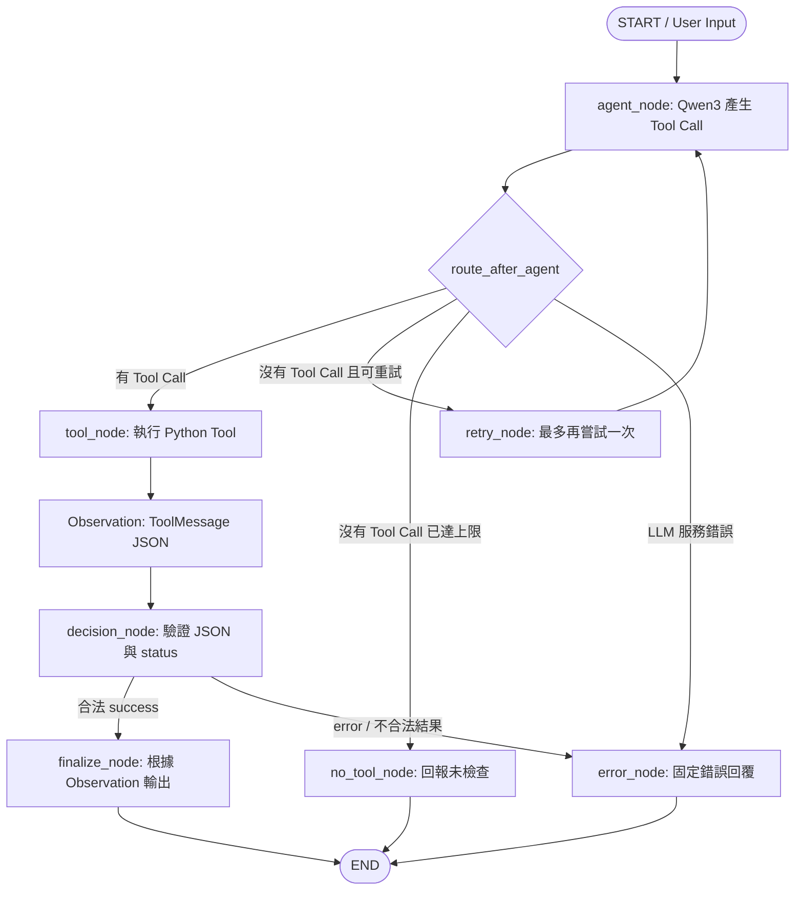

# ISO 26262 功能安全文件審查 AI Agent

**指定作業二｜可執行 Agent + Tool Calling / State-based Decision（MVP）**
**第一次作業規劃題目：** 基於 LLM 決策、RAG 與工具調用之 ISO 26262 功能安全文件審查 AI Agent
**主要技術：** Python 3.12、LangGraph、LangChain、Qwen3 4B Instruct、Ollama、Podman、openpyxl

**Repository：** https://github.com/Lincoln951753/ISO26262_AI_Agent

**指定作業二繳交日期：** 2026-11-22

> **閱讀與驗收說明**：這份 README 是指定作業二的主要驗收入口，包含需求對照、架構、Tool Definition、Podman 建置／執行、完整 Trace、Failure Cases、AI 輔助開發與驗收限制。`TOOL_DEFINITION.md` 為工具的補充文件。
>
> **能力邊界**：本階段僅對**模擬 Excel** 的 SG（Safety Goal）→ FSR（Functional Safety Requirement）→ TSR（Technical Safety Requirement）之**結構化 ID 追溯關係**進行規則檢查。尚未實作 ISO 26262 條款 RAG、PDF 解析、需求語義判讀、正式合規評定或產品功能安全認證。工具發現追溯缺漏，不代表已經判定違反 ISO 26262。
>
> **版本與證據須知**：本 README 說明正在 `assignment2-hardening` 分支測試的強化版。使用者已在 Windows 11 + WSL2 + Podman 對強化版完成 TC-01、FC-01、FC-02、FC-03，並在 Podman 中執行 17 組 Tool 單元測試；對應結果分別保存於 `logs/`。原公開 `main` 的 `a7701e2` 版本另有「從 GitHub 重新 Clone → 無快取 Build → 執行」的驗證紀錄。**強化版尚未合併 / Push 到 `main`，也尚未從新 Commit 乾淨 Clone 或在不同作業系統驗證。** 正式繳交前須完成第 8 節的最終驗收。

---

## 1. 老師作業規範與繳交要求對照

### 1.1 作業二必要項目（第 6.1、6.2、6.6 節）

| 要求 | 對應實作與證據 |
| --- | --- |
| 由作業一設計轉為可執行 Agent | [`agent.py`](agent.py)：LangGraph StateGraph、LLM Tool Calling 與條件式流程 |
| User Input → Agent → LLM / Agent Logic → Output | 第 3 節 Agent 工作流；第 5 節操作指令；第 6 節強化版端到端 Trace |
| 至少一個可實際執行的 Tool | `traceability_check`：讀取 Excel，回傳真實 JSON Observation |
| Tool Definition：名稱、目的、輸入、輸出、Error Handling | 第 4 節與 [`TOOL_DEFINITION.md`](TOOL_DEFINITION.md) |
| 一組完整 Agent Trace | 第 6.1 節：User Input → Decision → Tool Call → Observation → Decision → Final Answer |
| 至少兩組 Failure Cases | FC-01 檔案不存在、FC-02 缺必要欄位、FC-03 模型連線失敗；第 6、7 節 |
| 原始碼、README、部署方式、測試資料／結果 | [`agent.py`](agent.py)、[`Containerfile`](Containerfile)、[`requirements.txt`](requirements.txt)、[`test_data/`](test_data/)、[`logs/`](logs/) |
| Podman Engine 容器化 | 第 5 節；第 8 節記錄目前已驗證與尚待驗證項目 |

本專案採 **Tool Calling + State-based Decision**，不以完整 ReAct、自主長期 Planning 或 RAG 作為已完成能力。老師允許依專案需求選擇合適 Agent 機制，而非強制使用所有技術。

### 1.2 作業二配分（占學期總成績 20%）

| 評分項目 | 配分 | 驗收證據 |
| --- | ---: | --- |
| Working Agent 可執行性 | 6% | 第 5 節容器命令、強化版 TC-01 與三個 Failure Cases 的實測輸出 |
| Tool / Workflow / ReAct / Planning | 5% | LLM 提出 Tool Call、Python Tool 真正執行、LangGraph Decision |
| Agent 功能完整性 | 3% | SG/FSR/TSR 結構化追溯檢查 MVP |
| Error Handling | 2% | Tool Error、LLM 服務錯誤及 Exit Code 已實測；無 Tool Call 的分支尚未端到端實測 |
| Testing / Failure Evidence | 2% | TC-01、FC-01～03 日誌、17 組 unittest 結果與第 8 節驗收清單 |
| README / 執行環境 | 2% | 第 4～5、8～10 節與專案檔案索引 |

本表表示**提供證據的位置**，不是教授或助教已核定的分數。

---

## 2. 專案目的、使用情境與階段範圍

### 2.1 背景與使用者

ISO 26262 功能安全開發涉及 HARA、FSC、TSC 等文件，以及 Safety Goal（SG）、Functional Safety Requirement（FSR）、Technical Safety Requirement（TSR）等不同層級的安全需求。當文件增多時，人工確認需求 ID 的參照、缺漏與追溯關係容易耗時。本專案以**功能安全工程師、車用系統研發與文件審查人員**為目標使用者，開發可供人工複核的輔助工具。

第一次作業的完整構想包括文件解析、標準知識檢索（RAG）、Tool Calling、流程規劃、差距分析報告等。第二次作業為**可執行的最小雛形**，先聚焦證明下列閉環可運作：

1. `REVIEW_FILE` 指定一份專案內模擬 Excel。
2. Qwen3 理解審查請求並提出 `traceability_check` Tool Call。
3. Python `openpyxl` 工具真正讀取 Excel，檢查 SG/FSR/TSR ID 參照。
4. Tool 將結果包裝成 `ToolMessage`（Observation）。
5. LangGraph 檢查 Observation 狀態與資料結構，決定成功輸出或錯誤處理。
6. Console 顯示完整 Trace，並以 Podman 封裝應用程式。

### 2.2 與第一次作業功能需求（FR）的對照

| 需求 | 第一階段原規劃 | 作業二 MVP 達成程度 |
| --- | --- | --- |
| FR-01 | 上傳 Excel/PDF 文件 | **尚未完成上傳介面**；現以 `REVIEW_FILE` 指定 `test_data/` 中 Excel |
| FR-02 | 文件解析 | **部分**：固定 Schema 的 Excel 解析；無 PDF |
| FR-03 | Agent 規劃與選擇工具 | **部分**：LLM 選用一種 Tool；尚無多工具自主規劃 |
| FR-04 | RAG 檢索 ISO 條款 | **未實作**；後續階段 |
| FR-05 | 追溯性、欄位、語義與證據檢查 | **部分**：欄位、ID 重複與空白、無效／歧義引用與缺漏；尚無語義／證據評估 |
| FR-06 | Observation 後調整／錯誤控制 | **部分**：State-based success/error 路由與有限無工具重試；不是完整 Replanning |
| FR-07 | 來源與條款支持的 Gap Report | **未實作**；目前只有文字／JSON 檢查結果 |
| FR-08 | 保存審查與工具紀錄 | **部分**：Console Trace 可輸出為文字檔；尚無 SQLite 歷史管理 |

**縮減範圍理由**：作業二評分重點是可執行的 Agent、真實 Tool、Agent Trace、Failure Cases 與可重現性。因此先完成可測試的結構化追溯閉環，再於後續作業依既定規劃加入 RAG、文件解析、進階審查及評估。

### 2.3 技術選擇

| 技術 | 本階段 | 原因 |
| --- | --- | --- |
| Qwen3 + Ollama | 使用 | 本地模型作為 LLM Tool Selection 來源 |
| LangGraph | 使用 | 顯式 StateGraph、節點分工與條件分流，便於 Trace |
| Python + openpyxl | 使用 | 結構化欄位／ID 關係可由確定性規則驗證 |
| Podman | 使用 | 課程要求容器化執行與重現 |
| ReAct（完整循環） | 不使用 | 本期只有單一規則檢查工具，不需要自主多步推理迴圈 |
| RAG | 尚未使用 | 需另外建立合法標準知識來源、引用和正確性評估 |
| Memory / SQLite | 尚未使用 | 本期只檢查單次 Excel；持續任務記憶留待後續 |
| Multi-Agent / Self-Reflection | 不使用 | MVP 不需要額外增加複雜度 |

---

## 3. Agent 系統架構與原理

### 3.1 Podman 元件架構

```text
Windows 11 + WSL2（已實測主機）
  └─ Podman Engine / iso26262-net
       ├─ Ollama Container
       │    └─ qwen3:4b-instruct  /  http://ollama:11434
       └─ Python Agent Container（Containerfile）
            ├─ agent.py                LangGraph / LLM Tool Calling
            ├─ tools/traceability_check.py
            ├─ test_data/*.xlsx         模擬需求資料
            └─ test_tool.py            17 組單元測試
```

`OLLAMA_BASE_URL=http://ollama:11434` 是**容器之間**透過 Podman 網路通訊的位址。`REVIEW_FILE` 則是本期 CLI 的使用者輸入參數來源，並非 Web UI 或檔案上傳功能。

### 3.2 重構版 Agent Workflow



**完整 Trace 對應老師要求的六階段：** `User Input → Agent Decision → Tool Call → Observation → Agent Decision → Final Answer`。

### 3.3 為何要這樣設計？

1. **LLM 負責工具選擇，而不是取代資料來源。** Qwen3 透過 LangChain `bind_tools()` 產生工具名稱與 `file_path`，無法自行讀取 Excel；`tool_node()` 才實際呼叫 Python。
2. **Observation 是驗證基礎。** `traceability_check` 返回 JSON；成功執行 `status=success` 與找到追溯問題 `issue_count>0` 是兩件事。
3. **State-based Decision 採程式化規則。** `decision_node()` 檢查 status、summary、issues、row 等結構，才能進入 `finalize_node()`；發生錯誤則進 `error_node()`，避免讓模型補造行號或安全結論。
4. **Fail-closed：沒有證據就不能宣稱已審查。** 第一次 LLM 無 Tool Call 時有限重試；兩次都無工具則由 `no_tool_node()` 回報未完成。Ollama 連線例外也會顯示明確失敗。
5. **最終結果以可追溯資訊為主。** `finalize_node()` 將 Tool Observation 轉成固定格式文字，保留需求 ID、問題類型與 Excel 實際列號；這是刻意降低生成式文字的不確定性。
6. **不是完整 ReAct。** 有有限重試與條件分支，但沒有多工具目標分解、反覆自主 Planning、RAG 或語義驗證，不應過度宣稱。

### 3.4 主要程式節點

| 元件 | 功能 |
| --- | --- |
| `ReviewState` | 記錄 messages、指定檔案、LLM 次數、錯誤、Observation、決策 |
| `agent_node()` | 對 Qwen3 提出任務；取得 Tool Call；捕捉 LLM 呼叫例外 |
| `route_after_agent()` | 根據有無 Tool Call、是否已達重試上限、是否有服務錯誤決定方向 |
| `retry_node()` | 第一次未呼叫工具時，要求模型再嘗試一次 |
| `tool_node()` | 檢查 Tool 名稱、數量、參數與指定檔名後才執行 Python Tool |
| `latest_tool_observations()` | 解析最新一批 ToolMessage 的 JSON |
| `decision_node()` | 檢查 Observation 內容是否有效，產生第二次 Agent Decision |
| `route_after_decision()` | 指向 `finalize` 或 `error` |
| `finalize_node()` | 使用有效 Observation 生成固定結果，不再讓 LLM 猜測缺失 |
| `no_tool_node()` | 未成功取得工具呼叫時回報檢查未執行 |
| `error_node()` | 固定回報服務或工具錯誤，並禁止合規推論 |

---

## 4. Tool Definition：`traceability_check`

### 4.1 名稱、目的、輸入、輸出

| 欄位 | 定義 |
| --- | --- |
| Tool Name | `traceability_check` |
| Purpose | 以 Python 規則檢查 SG → FSR → TSR Excel ID 追溯關係 |
| Agent Binding | `@tool("traceability_check")` 的 `check_excel(file_path: str)` |
| Actual Function | [`tools/traceability_check.py`](tools/traceability_check.py) 的 `traceability_check(file_path)` |
| Input | `file_path: str`，例如 `safety_requirements.xlsx` |
| Output（成功） | JSON：`status=success`、`summary`、`issues` |
| Output（錯誤） | JSON：`status=error`、`message` |
| Error Handling | 檔案、工作表、必要欄位、工具參數、解析等錯誤，回報錯誤並由 LangGraph 決策分流 |

**限定讀取位置**：只允許 `test_data/` 內的 `.xlsx` 檔名，拒絕帶路徑分隔符或非 `.xlsx` 的輸入。新版 Agent 另外核對 Tool Call 的 `file_path` 是否與 `REVIEW_FILE` 一致。這是輸入限制措施，不代表已完成全面的檔案安全性審計。

### 4.2 專案自訂 Excel 格式

| Sheet | 必要欄位 | 意義 |
| --- | --- | --- |
| `SG` | `ID`, `Description` | 安全目標及描述 |
| `FSR` | `ID`, `SG_ID`, `Description` | 功能安全需求，單一 SG 引用欄位 |
| `TSR` | `ID`, `FSR_ID`, `Description` | 技術安全需求，單一 FSR 引用欄位 |

標題位於第 1 列，資料自第 2 列開始，輸出的 `row` 為實際 Excel 列號。**這些 Excel 欄名是本專案測試格式，不是 ISO 26262 所規定的固定欄名。**

### 4.3 工具的處理方式

1. 限制可讀取的路徑與副檔名，只允許專案 `test_data/` 內的 `.xlsx`。
2. 確認 `SG`、`FSR`、`TSR` 工作表存在且必要欄名正確；缺表頭、缺欄位、重複必要欄位或完全沒有需求資料則返回 `status=error`。
3. 逐列讀取 Excel，保留實際列號；完全空白列會略過。
4. 檢查各層 `ID` 是否重複或空白、`Description` 是否空白。
5. 檢查 FSR 引用 SG、TSR 引用 FSR 時，識別不存在或重複而產生歧義的上層 ID。
6. 檢查唯一可識別的 SG 是否有 FSR、FSR 是否有 TSR；若子需求本身的 ID 重複或空白，仍以實際引用列判定是否「存在子需求引用」，避免將資料品質缺陷重複誤判為沒有追溯關係。
7. 將 `status`、`summary`、`issues` 與實際 Excel 列號回傳給 Agent 作 Observation。

目前已實作的 Issue 類型包含：`INVALID_SG_REFERENCE`、`INVALID_FSR_REFERENCE`、`AMBIGUOUS_SG_REFERENCE`、`AMBIGUOUS_FSR_REFERENCE`、`SG_WITHOUT_FSR`、`FSR_WITHOUT_TSR`、`DUPLICATE_SG_ID`、`DUPLICATE_FSR_ID`、`DUPLICATE_TSR_ID`、`MISSING_ID`、`MISSING_DESCRIPTION`。

**限制**：此工具尚未檢查需求文字是否符合 ISO 26262、ASIL 分配、設計／測試證據，也不支援多對多需求引用；`status=success` 僅表示工具執行完成，即使 `issue_count > 0` 亦然。

### 4.4 正常工具輸出（強化版 TC-01 實測 Observation）

```json
{
  "status": "success",
  "summary": {
    "SG_count": 2,
    "FSR_count": 2,
    "TSR_count": 1,
    "issue_count": 1
  },
  "issues": [
    {
      "type": "FSR_WITHOUT_TSR",
      "requirement": "FSR-002",
      "row": 3,
      "message": "FSR FSR-002 has no TSR"
    }
  ]
}
```

這裡 `status=success` 只代表**工具完成檢查**，但 `issue_count=1` 代表找到一筆需求追溯缺漏。它不是 ISO 26262 合規判斷。

### 4.5 錯誤輸出及處置

| 錯誤 | 原因 | 處置 |
| --- | --- | --- |
| File Not Found | 指定 Excel 不存在 | 回報路徑，停止審查；確認檔名並重新執行 |
| Missing Sheet | 缺 SG / FSR / TSR 工作表 | 回報缺少的工作表 |
| Missing Column | 缺少必要欄名 | 回報工作表及欄位名稱 |
| Empty Sheet | 沒有表頭資料 | 回報無效工作表 |
| Excel Parsing Error | 工作簿內容無法解析 | 回報解析錯誤，不臆測資料 |
| Invalid Tool Input | 檔名非允許格式、模型改寫檔名、Tool 不符合要求 | 拒絕 Tool Call，產生 `status=error` |
| Invalid Tool Observation | JSON 無效或 summary 與 issues 不一致 | 導向 `error_node` |
| No Tool Call | 模型未提出所需工具呼叫 | 最多額外嘗試一次，仍沒有就回報未完成 |
| LLM Service Error | Ollama 服務失敗或模型無法回應 | `error_node` 產生固定錯誤回覆 |

注意：TC-01、FC-01、FC-02、FC-03 與 Exit Code 已在強化版 Podman Image 上實測；「模型連續未呼叫 Tool」及「不合法 Observation」分支仍需要獨立的 Agent 層級測試，不應先宣稱已實測通過。`TOOL_DEFINITION.md` 是補充文件，正式 Push 前也應核對其 Issue 清單是否同步。

---

## 5. Podman 建置與執行（PowerShell）

### 5.1 環境與相依性

| 項目 | 目前已有的實測環境 |
| --- | --- |
| 主機 | Windows 11 x64、WSL2 |
| IDE / Terminal | Visual Studio Code、PowerShell |
| 容器引擎 | Podman CLI 6.1.4、Podman Machine（WSL） |
| Agent Base Image | `python:3.12-slim` |
| Python Packages | `requirements.txt`：LangGraph、LangChain Core、LangChain Ollama、openpyxl（測試時使用 3.1.5） |
| LLM Server | Ollama Podman Container |
| 模型 | `qwen3:4b-instruct`（既有模型 ID：`0edcdef34593`） |
| Container Network | `iso26262-net` |

> 專案使用兩個容器，**Agent 與 Ollama 都由 Podman 啟動**。`requirements.txt` 的部分依賴採版本範圍，Ollama 使用 `latest`，因此完整鎖版與不同作業系統的重現性仍有待改善。部署時請記錄實際版本。

### 5.2 Clone 專案

```powershell
git clone https://github.com/Lincoln951753/ISO26262_AI_Agent.git
cd ISO26262_AI_Agent
git log -1 --oneline
```

如在現有工作資料夾開發，請確認位於預期分支。`git clone` 預設下載公開 `main`；**目前強化版仍在本機 `assignment2-hardening` 分支，正式 Push 前 GitHub `main` 並未包含此版。**

### 5.3 啟動 Podman Machine（Windows）

```powershell
podman --version
podman machine list
podman machine start
```

Machine 已經 `Currently running` 時，不需要重新啟動。確認引擎可用：

```powershell
podman ps -a
podman network ls
```

### 5.4 建立網路與 Ollama Container

**首次建立**（既有同名容器／網路時不要重複執行建立命令）：

```powershell
podman network create iso26262-net
podman run -d --name ollama --network iso26262-net -p 127.0.0.1:11434:11434 -v ollama:/root/.ollama docker.io/ollama/ollama:latest
podman exec ollama ollama pull qwen3:4b-instruct
```

如果容器已存在但停止，執行 `podman start ollama`；如容器未加入專用網路，確認後執行 `podman network connect iso26262-net ollama`。

檢查：

```powershell
podman exec ollama ollama list
Invoke-RestMethod -Uri http://127.0.0.1:11434/api/version
podman inspect ollama --format "{{json .NetworkSettings.Networks}}"
```

### 5.5 建立 Python Agent Image

在包含 `Containerfile` 的專案根目錄：

```powershell
podman build -t iso26262-agent:dev -f Containerfile .
```

**測試重新安裝套件**（選做，較嚴格的可重現性檢查）：

```powershell
podman build --no-cache -t iso26262-agent:verify-nocache -f Containerfile .
```

`Containerfile` 也包含 `COPY test_tool.py .`，讓 unittest 可以直接在 Podman 內執行。**修改 Python 或 Excel 後需重新 Build**；重跑舊 Image 不能驗證新版檔案。

### 5.6 執行 TC-01（正常工具執行）

```powershell
podman run --rm --network iso26262-net -e OLLAMA_BASE_URL=http://ollama:11434 -e REVIEW_FILE=safety_requirements.xlsx iso26262-agent:dev
```

應有六段 Trace，Tool Observation 需要顯示 `FSR_WITHOUT_TSR`、`FSR-002`、Excel row 3。強化版成功路徑的 `Next Node` 為 `finalize`，已在本機 Podman 實測。正常執行應回傳 Exit Code `0`；發現需求缺漏不代表程式失敗。

### 5.7 執行 FC-01 與 FC-02（兩個 Failure Cases）

```powershell
# FC-01：檔案不存在
podman run --rm --network iso26262-net -e OLLAMA_BASE_URL=http://ollama:11434 -e REVIEW_FILE=not_found.xlsx iso26262-agent:dev

# FC-02：FSR 缺少 SG_ID 欄位
podman run --rm --network iso26262-net -e OLLAMA_BASE_URL=http://ollama:11434 -e REVIEW_FILE=fc02_missing_column.xlsx iso26262-agent:dev
```

預期都會出現 `Observation Status: error`、`Next Node: error`，分別回報 `File not found` 與 `FSR missing columns: ['SG_ID']`。兩個案例屬於**系統正確處理錯誤輸入**，不是檔案審查通過；強化版預期 Exit Code `1`。

### 5.8 FC-03：Ollama 服務連線失敗

刻意將 Ollama URL 設成不存在的連接埠，**不必停止既有 Ollama 容器**：

```powershell
podman run --rm --network iso26262-net -e OLLAMA_BASE_URL=http://ollama:19999 -e REVIEW_FILE=safety_requirements.xlsx iso26262-agent:dev
Write-Host "FC-03 Exit Code: $LASTEXITCODE"
```

預期 `LLM service error (ConnectError)`，沒有未處理的 Python Traceback，Exit Code 為 `1`。此案例在強化版已實測通過。

### 5.9 在 Podman 執行自動化 Tool 測試

```powershell
podman run --rm --entrypoint python iso26262-agent:dev test_tool.py
Write-Host "Tool Test Exit Code: $LASTEXITCODE"
```

預期 `Ran 17 tests`、`OK`、`Exit Code: 0`。17 組測試驗證**Python Excel Tool**，並非 17 組含 Qwen3 的端到端 Agent 測試。`test_tool.py` 利用 `unittest`、`openpyxl` 和暫存 Excel 進行測試，不需要 Ollama 容器。

### 5.10 保存執行 Trace 與測試日誌

在專案根目錄建立 `logs/` 後執行：

```powershell
cmd /c "podman run --rm --network iso26262-net -e OLLAMA_BASE_URL=http://ollama:11434 -e REVIEW_FILE=safety_requirements.xlsx iso26262-agent:dev > logs\tc01_trace.txt 2>&1"
cmd /c "podman run --rm --network iso26262-net -e OLLAMA_BASE_URL=http://ollama:11434 -e REVIEW_FILE=not_found.xlsx iso26262-agent:dev > logs\fc01_trace.txt 2>&1"
cmd /c "podman run --rm --network iso26262-net -e OLLAMA_BASE_URL=http://ollama:11434 -e REVIEW_FILE=fc02_missing_column.xlsx iso26262-agent:dev > logs\fc02_trace.txt 2>&1"
cmd /c "podman run --rm --network iso26262-net -e OLLAMA_BASE_URL=http://ollama:19999 -e REVIEW_FILE=safety_requirements.xlsx iso26262-agent:dev > logs\fc03_trace.txt 2>&1"
cmd /c "podman run --rm --entrypoint python iso26262-agent:dev test_tool.py > logs\tool_unittest_trace.txt 2>&1"
```

**重要：** 上述 `:dev` 是正式 Clone 後的建置標籤；本次開發驗證使用 `iso26262-agent:hardening`。任何程式修改後都應重新 Build、確認每組 Exit Code，再檢查 `logs` 中中文是否正常。PowerShell 5.1 的 `Tee-Object` 曾出現中文亂碼，因此這裡使用 `cmd /c` 重導向。

## 6. Agent Trace：強化版實際執行結果

> 下列內容依照使用者在 **Windows 11 + WSL2 + Podman** 執行 `iso26262-agent:hardening` 後提供的真實輸出整理；同時已保存於 `logs/`。測試所在分支為本機 `assignment2-hardening`，**目前尚未合併／推送正式 `main`，也尚未完成強化版乾淨 Clone 或跨平台驗證**。

### 6.1 TC-01：正常工具呼叫並發現 FSR 缺少 TSR

**Input**：`safety_requirements.xlsx`；**預期**：`FSR-002` 缺少 TSR、Excel 第 3 列；**實際 Exit Code：0（PASS）**。

```text
=== User Input ===
請使用工具檢查 safety_requirements.xlsx 的 SG、FSR、TSR 追溯關係，列出問題與 Excel 列號；如果檢查無法完成，請回報錯誤。

=== Agent Decision (before Tool Call) ===
Decision: call the tool(s) listed below

=== Tool Call ===
Tool: traceability_check
Arguments: {'file_path': 'safety_requirements.xlsx'}

=== Observation ===
{"status": "success", "summary": {"SG_count": 2, "FSR_count": 2, "TSR_count": 1, "issue_count": 1}, "issues": [{"type": "FSR_WITHOUT_TSR", "requirement": "FSR-002", "row": 3, "message": "FSR FSR-002 has no TSR"}]}

=== Agent Decision (after Observation) ===
Observation Status: success
Next Node: finalize
Reason: Valid Tool Observation; produce an evidence-based final result.

=== Final Answer ===
SG／FSR／TSR 結構化追溯性檢查已完成（工具執行成功）。
SG：2 筆；FSR：2 筆；TSR：1 筆。
發現 1 項追溯性問題：
- FSR_WITHOUT_TSR：FSR-002（Excel 第 3 列）。
注意：這是模擬 Excel 的結構檢查，並非 ISO 26262 條款或符合性判定。
```

完整保存檔：[`logs/tc01_trace.txt`](logs/tc01_trace.txt)。

### 6.2 FC-01：Excel 不存在

**Input**：`not_found.xlsx`；**預期**：回報不存在、不虛構資料；**實際 Exit Code：1（預期失敗情境處理成功）**。

```text
=== User Input ===
請使用工具檢查 not_found.xlsx 的 SG、FSR、TSR 追溯關係，列出問題與 Excel 列號；如果檢查無法完成，請回報錯誤。

=== Agent Decision (before Tool Call) ===
Decision: call the tool(s) listed below

=== Tool Call ===
Tool: traceability_check
Arguments: {'file_path': 'not_found.xlsx'}

=== Observation ===
{"status": "error", "message": "File not found: /app/test_data/not_found.xlsx"}

=== Agent Decision (after Observation) ===
Observation Status: error
Next Node: error
Reason: File not found: /app/test_data/not_found.xlsx

=== Final Answer ===
本次追溯性檢查無法完成。
錯誤原因：File not found: /app/test_data/not_found.xlsx
請確認檔案、模型服務或工具輸入後重新執行。
沒有可靠的檢查結果，不能判定追溯性或 ISO 26262 符合性。
```

完整保存檔：[`logs/fc01_trace.txt`](logs/fc01_trace.txt)。

### 6.3 FC-02：缺少必要欄位

**Input**：`fc02_missing_column.xlsx`；**預期**：回報 `FSR` 缺 `SG_ID`；**實際 Exit Code：1（預期失敗情境處理成功）**。

```text
=== User Input ===
請使用工具檢查 fc02_missing_column.xlsx 的 SG、FSR、TSR 追溯關係，列出問題與 Excel 列號；如果檢查無法完成，請回報錯誤。

=== Agent Decision (before Tool Call) ===
Decision: call the tool(s) listed below

=== Tool Call ===
Tool: traceability_check
Arguments: {'file_path': 'fc02_missing_column.xlsx'}

=== Observation ===
{"status": "error", "message": "FSR missing columns: ['SG_ID']"}

=== Agent Decision (after Observation) ===
Observation Status: error
Next Node: error
Reason: FSR missing columns: ['SG_ID']

=== Final Answer ===
本次追溯性檢查無法完成。
錯誤原因：FSR missing columns: ['SG_ID']
請確認檔案、模型服務或工具輸入後重新執行。
沒有可靠的檢查結果，不能判定追溯性或 ISO 26262 符合性。
```

完整保存檔：[`logs/fc02_trace.txt`](logs/fc02_trace.txt)。

### 6.4 FC-03：Ollama 服務無法連線

**Input**：正常 Excel，但設定 `OLLAMA_BASE_URL=http://ollama:19999`；**預期**：在 LLM 階段直接回報錯誤，不呼叫工具；**實際 Exit Code：1（預期失敗情境處理成功）**。

```text
=== User Input ===
請使用工具檢查 safety_requirements.xlsx 的 SG、FSR、TSR 追溯關係，列出問題與 Excel 列號；如果檢查無法完成，請回報錯誤。

=== Agent Decision (LLM Service Failure) ===
Decision: error

=== Final Answer ===
本次追溯性檢查無法完成。
錯誤原因：LLM service error (ConnectError): [Errno 111] Connection refused
請確認檔案、模型服務或工具輸入後重新執行。
沒有可靠的檢查結果，不能判定追溯性或 ISO 26262 符合性。
```

由於在呼叫 LLM 時已失敗，FC-03 沒有 Tool Call／Observation 是合理的；第 6.1 節的 TC-01 才是要求的完整六階段 Agent Trace。完整保存檔：[`logs/fc03_trace.txt`](logs/fc03_trace.txt)。

## 7. Failure Cases、測試證據與改善方法

| Case | 情境 | Observation / 行為 | Exit Code | 本機驗收 |
| --- | --- | --- | ---: | --- |
| TC-01 | FSR-002 缺少 TSR | `success`、Issue=`FSR_WITHOUT_TSR`、row 3 | `0` | PASS |
| FC-01 | 指定不存在的 Excel | `error`、File not found | `1` | PASS |
| FC-02 | FSR 缺少 `SG_ID` 欄位 | `error`、Missing column | `1` | PASS |
| FC-03 | Ollama 服務無法連線 | `LLM service error`、不虛構結果 | `1` | PASS |
| Tool unittest | 結構化 ID、欄位、引用、路徑與解析等 17 組案例 | `Ran 17 tests`、`OK` | `0` | PASS |

**Failure Case 1 — File Not Found：** 輸入 `not_found.xlsx`，工具因找不到檔案返回錯誤；Agent 進入 `error_node` 並保留錯誤原因，不編造缺漏或 ISO 26262 判定。排除方式為確認 `test_data/` 是否有正確檔名、必要時重新 Build 後執行。

**Failure Case 2 — Missing Required Column：** FSR 工作表缺少 `SG_ID` 欄，工具不能建立 FSR → SG 引用；返回 `FSR missing columns: ['SG_ID']` 並停止審查。排除方式為補上正確欄名與資料後重新測試。

**Failure Case 3 — LLM Service Failure：** 模擬 API Port 錯誤，Qwen3 無法連線；Agent 捕捉 `ConnectError`，不再進行 Tool Calling。排除方式為核對 Ollama 容器、模型、網路和 `OLLAMA_BASE_URL`。

**為何要程式化處理 Error？** 開發過程曾發現 LLM 在工具失敗時自行增加不存在的欄位或列號，因此把錯誤輸出交給程式，不依賴另一輪自由文字生成。`status=success` 表示工具執行成功；即使 `issue_count>0`，程序仍應正常退出 `0`。缺檔、缺欄位、LLM 失聯等無法完成審查時，程序回傳非零 `1`，可供腳本和 CI 判定。

### 7.1 自動化 Tool 測試（17 組）

[`test_tool.py`](test_tool.py) 使用 Python `unittest` 及暫存 Excel，自動建立並檢查有效引用、缺漏引用、重複 ID、歧義引用、空白欄位、全空列、無資料、缺工作表、缺必要欄名、重複表頭、缺檔、非法路徑、非 xlsx 及損壞活頁簿等案例。只檢查專案自訂資料結構，不判定 ISO 26262 合規性。

實測執行：

```powershell
podman run --rm --entrypoint python iso26262-agent:hardening test_tool.py
```

```text
Ran 17 tests in 0.147s

OK
Exit Code: 0
```

完成的測試證據存放於 [`logs/tool_unittest_trace.txt`](logs/tool_unittest_trace.txt)；`logs/` 中的完整輸出比本節節錄更適合用來檢查測試名稱。

### 7.2 手動補充情境與修正紀錄

除了自動化測試，使用者另在 Podman 以暫存 Excel 驗證：TC-02 重複 FSR ID、TC-03 空白 ID/Description、TC-04 無效 SG/FSR 引用，以及 TC-05 正常且沒有 Issue 的雙鏈結需求。這些是 **Tool 層級的臨時容器測試**，不是四組獨立的 LLM 端到端 Agent Trace。

TC-02 第一次執行時除正確的 `DUPLICATE_FSR_ID`、`AMBIGUOUS_FSR_REFERENCE` 外，還出現不應有的 `SG_WITHOUT_FSR`。經分析是把子需求 ID 有效性與「子需求是否存在引用」混為一談；修正工具後重新執行，**只保留兩筆正確 Issue** 並通過 `assert issue_count == 2`。此例展示先觀察實際執行結果、定位誤判、修改程式與回歸測試的過程。

**尚未端到端驗證的分支：** LLM 連續不呼叫 Tool、模型產生多個或錯誤 Tool Call、不合法 Observation。這些功能有保護性程式邏輯，但不能在沒有實際測試之前標示 PASS。

## 8. 可重現性、已完成驗證與繳交前驗收

### 8.1 GitHub 舊版乾淨 Clone 驗證（已完成）

使用者於 **2026-11-22** 在同一台 Windows 11 + WSL2 + Podman 主機上建立另一個資料夾 `ISO26262_AI_Agent_Verify`，從公開 GitHub 取得當時 `main` Commit：`a7701e2 docs: simplify README for assignment submission`。

| 驗證 | 實際結果 |
| --- | --- |
| Git Clone 與 Commit | 成功，`a7701e2` |
| Podman CLI / Machine | 6.1.4，WSL Machine 執行中 |
| Ollama / Model | `ollama` 連接 `iso26262-net`；`qwen3:4b-instruct`、模型 ID `0edcdef34593` |
| 原版容器重新 Build | 成功；第一輪部分步驟使用 Cache |
| 原版 TC-01、FC-01、FC-02 | 三組端到端行為符合預期 |
| `--no-cache` 重新 Build | 成功；重新執行 Python 套件安裝 |
| 無快取 Image 再跑 TC-01 | 成功 |

這是**同一台主機不同資料夾的重新下載／建置測試**。`--no-cache` 不代表另一個作業系統或全新主機，也不保證重新拉取所有基底映像。

### 8.2 強化版本機 Podman 驗證（已完成）

強化版位於本機 `assignment2-hardening` 分支，使用 Image `iso26262-agent:hardening`。經 Podman 重新 Build 並實測：

| 項目 | 驗收結果 |
| --- | --- |
| `agent.py` 強化版 TC-01 | PASS，`finalize`、`FSR-002` row 3、Exit Code 0 |
| FC-01 檔案不存在 | PASS，`error`、Exit Code 1 |
| FC-02 必要欄位不存在 | PASS，`error`、Exit Code 1 |
| FC-03 Ollama 連線失敗 | PASS，`ConnectError`、Exit Code 1 |
| 重複 FSR ID 誤判修正 | PASS，僅 2 筆預期 Issue |
| 空白欄位、無效引用、完全正常需求 | 手動 Tool 測試 PASS |
| `test_tool.py` unittest | 17 / 17 PASS，Exit Code 0 |
| 重新產出 Trace | `logs/tc01_trace.txt`、`fc01_trace.txt`、`fc02_trace.txt`、`fc03_trace.txt` 與 `tool_unittest_trace.txt` |

**仍未完成：** 強化版合併／Push 後從 GitHub 再次乾淨 Clone → Build → Run，以及另一作業系統上的獨立 Podman 重現。不能把 8.1 的舊版 Clone 結果等同於強化版的 GitHub 重現，也不能宣稱跨平台已驗證。

### 8.3 驗收門檻與現況

| 驗收項目 | 通過門檻 | 現況 |
| --- | --- | --- |
| Working Agent | Podman 正常案例完成完整流程 | 強化版本機 PASS |
| Tool Calling | Python Tool 真正讀取模擬 Excel | 強化版本機 PASS |
| 完整 Agent Trace | Input → Decision → Tool → Observation → Decision → Final | 強化版 TC-01 PASS |
| 錯誤處理 | 兩組以上 Failure Cases，不編造結果 | FC-01～03 PASS |
| Exit Code | 成功 0；無法完成檢查非零 | TC-01 0；FC-01～03 1，PASS |
| 自動化測試 | 可重跑，能判斷 PASS / FAIL | 17 組 Tool unittest PASS |
| 同機 GitHub 乾淨 Clone | 從公開 Repo 建置並執行 | 舊版 `a7701e2` PASS；強化版 Push 後待重驗 |
| 跨平台 Podman | 另一作業系統獨立 Build / Run / Test | 尚未驗證 |
| 依賴版本 | 核心套件與容器映像可精確重現 | 尚未完全鎖版 |

### 8.4 依賴、環境與失敗情境注意事項

LangGraph / LangChain 的部分 Python 套件版本仍使用範圍，Ollama 容器仍使用 `latest`；時間不同可能裝到不同版本。正式繳交前應記錄實際套件版本，並視情況固定依賴。`ollama` 模型需要足夠記憶體；部署異常時應檢查 Podman Machine 資源與 API 可用性。

強化版應在 Push 後重新從 GitHub Clone，確認 `README.md`、`agent.py`、`tools/traceability_check.py`、`test_tool.py`、`Containerfile` 及 `logs/` 都是同一個 Commit。若跨平台測試無法於截止前完成，須明確保留限制說明，不可當成已通過。

## 9. 開發歷程、原理理解與 AI 輔助說明

### 9.1 AI 使用方式與課堂規範

依老師課堂口頭說明，**允許使用 ChatGPT、Claude、Gemini 等生成式 AI**，協助架構規劃、程式撰寫、除錯、技術概念理解與文件整理。但 AI 輔助不代表可以在不了解專案的情況下完全交由 AI 代做。學生仍須實際參與開發、理解 Agent 架構、Tool Calling、技術選擇，並自行執行、測試與驗證。

本專案採 **AI-assisted Development（AI 輔助開發）與 Active Learning（主動學習）**。我不是把 AI 產出的程式碼直接視為完成，而是透過對話追問設計原因、理解每個節點與工具的責任，將建議和課程學到的概念對照，再於 VS Code、PowerShell、Podman 中實際操作、觀察 Console Trace；若實際行為不符預期，就依錯誤訊息持續修正並重新驗證。

> **AI 輔助學習的價值，不在於 AI 幫我寫了多少程式碼，而在於我是否真正吸收、理解、能用自己的話說明，並將所學應用於實際開發與驗證。與 AI 互動是學習過程；能獨立解釋、操作、測試和承擔成果，才代表知識轉化為自己的能力。**

本專案部分 Python 程式、部署指令、錯誤處理邏輯與 README 由 ChatGPT 協助產生或重構，**不宣稱所有程式都是自行從零編寫**。實際參與內容包括：確定 ISO 26262 文件追溯性問題與 MVP 範圍、理解 Tool Calling 與 LangGraph 分流、建立 Podman/Ollama 環境、執行 GitHub Clone 與無快取 Build、觀察三組測試結果、理解失敗原因並要求重構。在強化版上，我親自執行本機 Podman Build、四個 Agent 案例、17 組 unittest，並針對重複 FSR ID 的誤判，透過對照 Observation 與 AI 討論邏輯、修改 Tool、重新測試；也驗證 Error Handling 的 Exit Code 由 0 改為 1。**AI 提供程式建議不代表自動通過驗收，必須由實際執行與觀察結果證明。**

### 9.2 具體學到的技術

| 主題 | 我需要能清楚解釋的原理 |
| --- | --- |
| LLM / Agent 差異 | LLM 生成工具請求；Agent Workflow 負責控制何時執行與如何根據結果決策 |
| Tool Calling | 模型提出 `name` + `arguments`，但不會自己執行 Python |
| Observation | Python Tool 的 JSON 才是列號、ID、缺漏的來源 |
| StateGraph | 分離 agent、tools、decision、finalize、error 節點，使用條件邊控制流程 |
| Error Handling | 真實 Tool Error 不應交由模型猜測或產生無依據的合規判斷 |
| 容器 | Podman 封裝 Python 執行環境，Agent 透過專用網路向 Ollama API 發出請求 |
| 測試與證據 | 設計上可行不等於已通過；只有實際執行並觀察結果才能標示 PASS |

### 9.3 實際除錯與回歸測試經驗

| 問題 | 原因與處置 |
| --- | --- |
| PowerShell `host directory cannot be empty` | 掛載變數格式錯誤，改用 `$($PWD.Path)` |
| Python `IndentationError` | 統一縮排，透過 `ast.parse()` 驗證語法 |
| `REVIEW_FILE` 指定後仍使用舊檔名 | 修正環境變數讀取、儲存程式、重新 Build Image |
| Trace 中文亂碼 | PowerShell 5.1 `Tee-Object` 編碼問題，改用 CMD 重導向 |
| 工具失敗時 LLM 虛構欄位或列號 | 不僅改 Prompt，改由確定性的 `error_node` 處理 |
| 只有一段 Decision Trace | 加入 `decision_node` 與 `tool_decision` 狀態，保存 Observation 後決策 |
| LLM 服務失敗但 Exit Code 為 0 | 加入 CLI 結束狀態判斷，實測錯誤回傳 1、正常工具檢查回傳 0 |
| 重複 FSR ID 導致額外回報 `SG_WITHOUT_FSR` | 分開處理有效引用與子需求是否存在，修正後重複 ID 情境只保留兩筆正確 Issue |
| 測試程式只有 print，無法自動判定錯誤 | 改成 17 組 `unittest` 並在 Podman 內執行 |

### 9.4 技術選擇的口頭說明要點

**為何不直接用 LLM 判讀 Excel？** ID、欄位、引用存在性屬於可程式化的確定性問題，Python 規則更方便驗證；LLM 適合從任務中選擇工具。

**為何是 LangGraph 而非只有 Python if/else？** LangGraph 使 Agent、Tool、Decision 與 Error 成為可觀察的節點與狀態轉移，能建立完整 Trace，也便於下一階段擴充。

**為何成功時改採程式化 Final Answer？** 安全需求 ID、Excel 列號應有實際工具證據；程式化輸出可以降低回答流暢但不可靠的風險。LLM 仍參與工具選擇。

**為何不是完整 ReAct / RAG？** 本期只有單一結構化 Tool；有限重試不是全面 Planning。RAG 尚未取得可合法檢索並準確引用的標準知識庫，暫不宣稱具備條款審查能力。

---

## 10. Repository 檔案與後續規劃

### 10.1 程式與文件索引（強化版預期提交內容）

```text
ISO26262_AI_Agent/
├── README.md
├── agent.py
├── Containerfile
├── requirements.txt
├── TOOL_DEFINITION.md
├── test_tool.py                 # 17 組 unittest
├── tools/
│   └── traceability_check.py
├── test_data/
│   ├── safety_requirements.xlsx
│   └── fc02_missing_column.xlsx
└── logs/
    ├── tc01_trace.txt
    ├── fc01_trace.txt
    ├── fc02_trace.txt
    ├── fc03_trace.txt
    └── tool_unittest_trace.txt
```

- **Agent：** [`agent.py`](agent.py)
- **Excel Tool：** [`tools/traceability_check.py`](tools/traceability_check.py)
- **Tool Definition 補充：** [`TOOL_DEFINITION.md`](TOOL_DEFINITION.md)
- **Podman 建置：** [`Containerfile`](Containerfile)
- **Python 相依性：** [`requirements.txt`](requirements.txt)
- **17 組可重跑測試：** [`test_tool.py`](test_tool.py)
- **實測日誌：** [`logs/`](logs/)

開發時建立的 `tools/traceability_check.backup.py` 為本機備份，不屬於正式交付；**請不要用 `git add .` 一併提交**。

### 10.2 目前限制

1. **尚未整合 ISO 26262 正式標準文件**，沒有條款檢索 RAG，也不能判定標準或產品符合性；目前只是模擬 Excel 的結構化 ID 審查 MVP。
2. Excel Tool 可找出已列出的 ID／欄位／引用問題，但不理解需求語義、不審查 ASIL 分配、設計／測試證據或多對多追溯。
3. 輸入限定專案 `test_data/` 的特定 `.xlsx` Schema，沒有 PDF 解析、檔案上傳、Web UI、報告下載或 SQLite 審查歷史管理。
4. 有限無工具重試及不合法 Observation 的防護已編寫，但尚未完成獨立的 Agent 層級端到端測試。
5. 強化版已在本機 Podman 測試；尚未完成新 Commit 的 GitHub 乾淨 Clone，以及另一個作業系統的獨立重現，依賴版本也尚未完全固定。

### 10.3 後續課程里程碑

| 階段 | 計畫與驗收方向 |
| --- | --- |
| 作業二（本次） | 可執行 Agent、真實 Tool、完整 Trace、三組 Failure Cases、17 組 Tool unittest、Podman 本機驗收與 README；提交後重新 Clone／驗證 |
| 作業三（功能強化與實驗） | 選擇一項有效的技術改善，提供至少 10 個測試案例，量測 Before / After 指標；本次 17 組 unittest 是工具層證據，不能直接代替完整 Agent 實驗 |
| 期末專案 | 視資源及合法來源逐步加入 RAG／PDF／報告／驗證證據等能力；完成技術報告和更全面的可重現性驗證 |

**結論**：本專案以可執行、可觀察、可測試的 Agent MVP 為作業二目標。AI 是協助理解、撰寫與除錯的工具；真正的學習是能解釋原理並由自己執行、分析與驗證結果。已取得強化版本機 Podman 測試證據，但不把尚未完成的 GitHub 新版乾淨 Clone 或跨平台驗證宣稱為 PASS。
