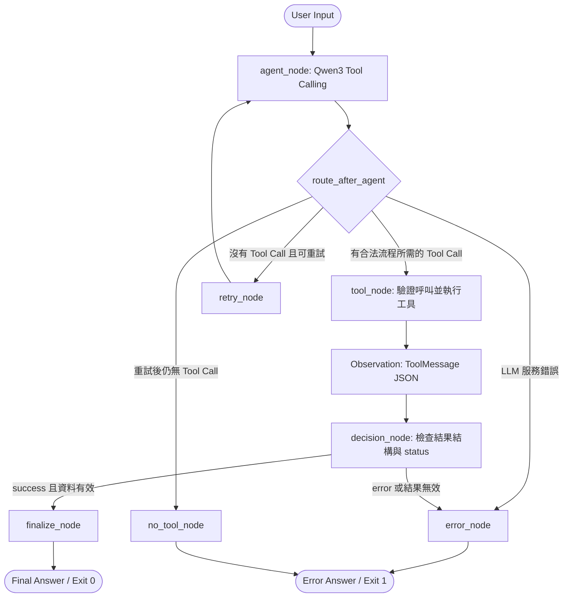

# ISO 26262 功能安全文件審查 AI Agent

**AI Agent 課程｜指定作業二：可執行 Agent 與工具調用**  
**專案類型：** Functional Safety Requirement Traceability Review（MVP）  
**核心技術：** Python、LangGraph、LangChain、Qwen3、Ollama、openpyxl、Podman  
**程式碼：** [GitHub Repository](https://github.com/Lincoln951753/ISO26262_AI_Agent)

## 專案摘要

本專案開發一個可在 **Podman 容器**中執行的 AI Agent，協助檢查車用功能安全需求文件的**結構化追溯關係**。使用者指定 Excel 檔案後，Agent 會讓本地端 LLM（Qwen3）選擇 `traceability_check` 工具，由 Python 實際讀取檔案、檢查 Safety Goal（SG）→ Functional Safety Requirement（FSR）→ Technical Safety Requirement（TSR）之間的 ID 引用，最後根據工具的檢查結果輸出問題類型、需求編號及 Excel 列號。

本作業重點不是讓 LLM 直接判定安全合規性，而是實現一個**可執行、可觀察、可重現且具備錯誤處理的 Agent 工作流程**：

`User Input → LLM Decision → Tool Call → Observation → State-based Decision → Final Answer`

> **能力範圍聲明：** 本專案目前使用**模擬的 Excel 需求資料**及專案定義的欄位格式，檢查 ID、欄位及需求追溯關係。**尚未整合 ISO 26262 正式標準條文、RAG、PDF 解析、需求語義判斷或符合性認證。** 工具檢查成功不等於符合 ISO 26262；發現追溯問題也不代表已判定違反某一標準條款。

### 作業二驗收摘要

| 項目 | 實作或證據 |
| --- | --- |
| 可執行 Agent | `agent.py`：LangGraph StateGraph + Qwen3 Tool Calling |
| 真實工具 | `tools/traceability_check.py`：以 `openpyxl` 讀取 Excel 並回傳 JSON |
| Tool Definition | 本文件第 3 節與 [`TOOL_DEFINITION.md`](TOOL_DEFINITION.md) |
| 完整 Agent Trace | 第 6 節 TC-01，包含六階段流程與實際 Observation |
| Failure Cases | FC-01 檔案不存在、FC-02 缺少欄位、FC-03 LLM 服務無法連線 |
| Error Handling | 檢查工具輸入、Observation、LLM 例外；失敗時回報原因且 Exit Code 為 `1` |
| 自動化測試 | `test_tool.py`：17 組 Python Tool 單元測試，已在 Podman 內通過 |
| 部署與重現 | `Containerfile`、`requirements.txt`、第 5 節執行指令 |
| 驗證證據 | `logs/` 提供正常案例、三組失敗案例及單元測試輸出 |

---

## 1. 問題背景與專案目標

在車用功能安全開發中，Safety Goal、Functional Safety Requirement 與 Technical Safety Requirement 位於不同需求層級，需建立可追溯的關聯。如果需求 ID 寫錯、上層需求不存在，或某項需求未連結至下一層需求，可能增加人工審查與後續維護成本。

本次作業選擇**規則可明確定義的結構化檢查**作為 Agent 的第一項實際能力：

1. 使用者透過 `REVIEW_FILE` 指定一個專案內的 `.xlsx` 檔案。
2. LLM 依照審查任務產生工具呼叫，而不是自行虛構 Excel 內容。
3. Python Tool 載入工作表，檢查欄位、資料品質與 SG／FSR／TSR 追溯關係。
4. Tool 以 JSON 回傳 Observation，保留問題類型、需求 ID 與實際列號。
5. Agent 依 Observation 成功或失敗，決定輸出結果或錯誤訊息。
6. 整個流程以 Console Trace 呈現，可由測試日誌重現與核對。

**使用情境：** 功能安全工程師在初步整理需求追溯表時，可以先用此工具找出結構性問題，再人工確認真正的功能安全需求與文件內容。這是**審查輔助工具**，不取代功能安全工程師的判斷。

### 本次實作與未實作項目

| 類別 | 本次作業範圍 |
| --- | --- |
| 已實作 | Excel 固定格式解析；SG／FSR／TSR ID 追溯性檢查；LLM Tool Calling；LangGraph 條件分流；錯誤處理；Console Trace；Podman 容器執行；17 組 Tool 單元測試 |
| 尚未實作 | 使用者檔案上傳介面、PDF 解析、ISO 26262 條款 RAG、ASIL 與語義判斷、多對多需求關係、正式 Gap Analysis Report、審查歷史資料庫、Web UI |

---

## 2. Agent 架構與工作原理

### 2.1 系統架構

```text
使用者／PowerShell
  └─ REVIEW_FILE=safety_requirements.xlsx
       │
       ▼
Podman：Python Agent Container
  ├─ agent.py
  │   ├─ LangGraph StateGraph
  │   ├─ LLM Tool Calling
  │   ├─ Observation 驗證
  │   └─ 最終結果／錯誤處理
  ├─ tools/traceability_check.py
  │   └─ openpyxl 讀取 test_data/*.xlsx
  └─ test_tool.py
       │
       │  iso26262-net
       ▼
Podman：Ollama Container
  └─ qwen3:4b-instruct
```

Python Agent 與 Ollama 分別在容器中執行，透過 Podman 網路 `iso26262-net` 連線。Agent 使用 `OLLAMA_BASE_URL=http://ollama:11434` 呼叫本地模型。

### 2.2 LangGraph 工作流程



**技術定位：Tool Calling + State-based Decision。** 本專案使用 LLM 選擇工具，並使用 LangGraph 明確管理流程節點與狀態。雖然包含有限重試與條件式決策，但**不宣稱具備完整 ReAct、多工具自主 Planning 或 Self-Reflection**。

### 2.3 各節點的責任

| 節點 | 功能 |
| --- | --- |
| `agent_node()` | 呼叫 Qwen3，取得 LLM 提出的 Tool Call；捕捉模型／API 例外 |
| `route_after_agent()` | 判斷要執行工具、有限重試，或回報失敗 |
| `retry_node()` | 首次沒有 Tool Call 時，要求 LLM 再嘗試一次；最多兩次 LLM 呼叫 |
| `tool_node()` | 檢查工具名稱、呼叫數量、參數與指定檔名，真正執行 Python Tool |
| `decision_node()` | 驗證 Observation JSON 的 `status`、`summary`、`issues` 及資料一致性 |
| `finalize_node()` | 根據**已驗證的工具結果**輸出需求編號、問題類型與 Excel 列號 |
| `error_node()` | 當工具或 LLM 失敗時，輸出固定格式錯誤及排除方向 |
| `no_tool_node()` | LLM 未成功呼叫工具時，明確說明審查沒有完成 |

此設計區分 **LLM 決策**與**實際資料驗證**。LLM 不直接讀取 Excel，也不在工具失敗後自行補造需求 ID 或結論；結構化檢查由 Python Tool 負責，成功輸出則由程式依 Observation 產生。

---

## 3. Tool Definition：`traceability_check`

### 3.1 工具定義

| 欄位 | 說明 |
| --- | --- |
| **Tool Name** | `traceability_check` |
| **Purpose** | 檢查專案自訂 Excel 中 SG → FSR → TSR 的結構化追溯關係與資料品質 |
| **Agent Interface** | `@tool("traceability_check")` 定義的 `check_excel(file_path: str)` |
| **Implementation** | `tools/traceability_check.py` 的 `traceability_check(file_path)` |
| **Input** | `file_path: string`，例如 `safety_requirements.xlsx` |
| **Success Output** | `{"status":"success","summary":{...},"issues":[...]}` |
| **Error Output** | `{"status":"error","message":"..."}` |
| **Error Handling** | 路徑、檔案、工作表、欄位、解析錯誤，以及 Agent 層 Tool Call／Observation 驗證 |

Agent 僅接受 `test_data/` 內的 `.xlsx` **檔名**，不可輸入任意絕對路徑或目錄跳脫字串；底層 Tool 亦會限制實際檔案位置。Agent 會核對模型指定的 `file_path` 是否與 `REVIEW_FILE` 一致，避免模型改成檢查其他檔案。

### 3.2 Excel 格式

本專案的 Excel 包含三個工作表，標題位於第 1 列，資料自第 2 列開始：

| Sheet | 必要欄位 | 功能 |
| --- | --- | --- |
| `SG` | `ID`, `Description` | Safety Goal 資料 |
| `FSR` | `ID`, `SG_ID`, `Description` | FSR 與上層 SG 的引用 |
| `TSR` | `ID`, `FSR_ID`, `Description` | TSR 與上層 FSR 的引用 |

```text
SG： SG-001  ←  FSR： FSR-001 / SG_ID=SG-001
                         ↑
                   TSR： TSR-001 / FSR_ID=FSR-001
```

欄名與單一上層引用方式是**本專案的測試資料格式**，並非 ISO 26262 規定的固定 Excel Schema。

### 3.3 主要檢查規則

| Issue Type | 檢查意義 |
| --- | --- |
| `INVALID_SG_REFERENCE` | FSR 未填有效 `SG_ID`，或引用的 SG 不存在 |
| `INVALID_FSR_REFERENCE` | TSR 未填有效 `FSR_ID`，或引用的 FSR 不存在 |
| `AMBIGUOUS_SG_REFERENCE` | FSR 引用的 SG ID 重複，無法唯一識別 |
| `AMBIGUOUS_FSR_REFERENCE` | TSR 引用的 FSR ID 重複，無法唯一識別 |
| `SG_WITHOUT_FSR` | 唯一可識別的 SG 未被 FSR 引用 |
| `FSR_WITHOUT_TSR` | 唯一可識別的 FSR 未被 TSR 引用 |
| `DUPLICATE_SG_ID`／`DUPLICATE_FSR_ID`／`DUPLICATE_TSR_ID` | 同層需求 ID 重複 |
| `MISSING_ID` | 需求資料列缺少 ID |
| `MISSING_DESCRIPTION` | 需求資料列缺少描述 |

此外，工具會檢查必要工作表、必要欄位、重複必要表頭及資料是否存在。完全空白列會跳過，結果的 `row` 保留**原始 Excel 列號**。

對於重複 ID，程式會把「子需求是否有引用上層需求」與「子需求 ID 本身是否唯一」分開處理，避免因重複 ID 再額外誤報不存在的追溯缺漏。

### 3.4 輸出格式

正常案例的實際 Tool Observation：

```json
{
  "status": "success",
  "summary": {
    "SG_count": 2,
    "FSR_count": 2,
    "TSR_count": 1,
    "issue_count": 1
  },
  "issues": [
    {
      "type": "FSR_WITHOUT_TSR",
      "requirement": "FSR-002",
      "row": 3,
      "message": "FSR FSR-002 has no TSR"
    }
  ]
}
```

此時 `status=success` 的意思是**工具已成功執行**，而 `issue_count=1` 則表示找到一個結構性問題。即使存在 Issue，成功完成檢查的程序仍回傳 Exit Code `0`。

當檔案無法檢查，例如必要欄位不存在：

```json
{
  "status": "error",
  "message": "FSR missing columns: ['SG_ID']"
}
```

此時不得推論檔案的需求追溯是否完整，Agent 應走錯誤處理流程，程序 Exit Code 為 `1`。

詳見 [`TOOL_DEFINITION.md`](TOOL_DEFINITION.md) 中的參數、安全限制與錯誤處理定義。

---

## 4. Repository 結構與執行環境

### 4.1 專案檔案

```text
ISO26262_AI_Agent/
├── README.md                       本文件
├── agent.py                        LangGraph Agent 與 CLI Trace
├── Containerfile                   Podman Image 建置定義
├── requirements.txt                Python 套件需求
├── TOOL_DEFINITION.md              工具完整規格
├── test_tool.py                    17 組 Tool 單元測試
├── tools/
│   └── traceability_check.py       Excel 結構化追溯檢查
├── test_data/
│   ├── safety_requirements.xlsx    TC-01 正常執行情境
│   └── fc02_missing_column.xlsx    FC-02 缺欄位情境
└── logs/
    ├── tc01_trace.txt              正常案例完整 Trace
    ├── fc01_trace.txt              檔案不存在
    ├── fc02_trace.txt              缺少必要欄位
    ├── fc03_trace.txt              Ollama 連線失敗
    └── tool_unittest_trace.txt     17 組 Tool 測試輸出
```

### 4.2 實測環境

| 項目 | 配置 |
| --- | --- |
| 主機 | Windows 11 x64 + WSL2 |
| 終端機 | VS Code PowerShell |
| Podman | 6.1.4，透過 Podman Machine（WSL）執行 |
| Python Base Image | `python:3.12-slim` |
| LLM 服務 | Ollama Container |
| 模型 | `qwen3:4b-instruct` |
| Python 套件 | LangGraph、LangChain Core、LangChain Ollama、openpyxl |
| 容器網路 | `iso26262-net` |

**重現性說明：** 測試證據來自上述 Windows + WSL2 + Podman 環境。其他作業系統尚未完成獨立重現測試；部分相依套件使用版本範圍，Ollama 映像使用 `latest`，因此不同時間安裝的精確版本可能不同。

---

## 5. Podman 安裝後的建置與執行步驟

以下命令以 **Windows PowerShell** 為例；操作前需安裝 Git 與 Podman，並啟用可執行容器的 Podman Machine。首次模型下載需要網路及足夠的磁碟空間。

### 5.1 下載專案

```powershell
git clone https://github.com/Lincoln951753/ISO26262_AI_Agent.git
cd ISO26262_AI_Agent
```

### 5.2 檢查 Podman

```powershell
podman --version
podman machine list
podman machine start
podman ps -a
```

若 Machine 已經執行中，`podman machine start` 可略過。Linux 原生 Podman 通常不需要 Podman Machine，直接檢查 `podman ps` 即可。

### 5.3 建立 Ollama 服務及模型

**第一次建立環境時執行：**

```powershell
podman network create iso26262-net
podman run -d --name ollama --network iso26262-net -p 127.0.0.1:11434:11434 -v ollama:/root/.ollama docker.io/ollama/ollama:latest
podman exec ollama ollama pull qwen3:4b-instruct
```

確認服務及模型：

```powershell
podman exec ollama ollama list
Invoke-RestMethod -Uri http://127.0.0.1:11434/api/version
```

若已有同名 `ollama` 容器，不要重複建立；停止時可使用 `podman start ollama`。如已啟動的 Ollama 不在 `iso26262-net`，需先確認網路狀態並正確連接。若本機 11434 Port 已被占用，需調整已執行的服務，避免重複綁定。

### 5.4 建置 Agent Image

在包含 `Containerfile` 的專案根目錄執行：

```powershell
podman build -t iso26262-agent:assignment2 -f Containerfile .
```

若需要排除 Build Cache 影響，可使用：

```powershell
podman build --no-cache -t iso26262-agent:assignment2 -f Containerfile .
```

修改 `agent.py`、`tools/`、`test_data/` 或 `test_tool.py` 後，須重新 Build，才能在容器中使用更新內容。

### 5.5 TC-01：正常執行 Agent

```powershell
podman run --rm --network iso26262-net -e OLLAMA_BASE_URL=http://ollama:11434 -e REVIEW_FILE=safety_requirements.xlsx iso26262-agent:assignment2
Write-Host "Exit Code: $LASTEXITCODE"
```

預期：Console 依序顯示 User Input、Agent Decision、Tool Call、Observation、Agent Decision 及 Final Answer；找到 `FSR_WITHOUT_TSR`、`FSR-002`、Excel 第 `3` 列，Exit Code 為 `0`。

### 5.6 FC-01：檔案不存在

```powershell
podman run --rm --network iso26262-net -e OLLAMA_BASE_URL=http://ollama:11434 -e REVIEW_FILE=not_found.xlsx iso26262-agent:assignment2
Write-Host "Exit Code: $LASTEXITCODE"
```

預期：Tool Observation 回傳 `File not found`，Agent 輸出錯誤原因，Exit Code `1`。

### 5.7 FC-02：Excel 缺少必要欄位

```powershell
podman run --rm --network iso26262-net -e OLLAMA_BASE_URL=http://ollama:11434 -e REVIEW_FILE=fc02_missing_column.xlsx iso26262-agent:assignment2
Write-Host "Exit Code: $LASTEXITCODE"
```

預期：回報 `FSR missing columns: ['SG_ID']`，Exit Code `1`。

### 5.8 FC-03：Ollama 服務連線失敗

刻意使用未提供服務的連接埠，**無須停止原本的 Ollama Container**：

```powershell
podman run --rm --network iso26262-net -e OLLAMA_BASE_URL=http://ollama:19999 -e REVIEW_FILE=safety_requirements.xlsx iso26262-agent:assignment2
Write-Host "Exit Code: $LASTEXITCODE"
```

預期：顯示 `LLM service error (ConnectError)`，不會憑空產生審查結論，Exit Code `1`。

### 5.9 執行 17 組自動化 Tool 測試

```powershell
podman run --rm --entrypoint python iso26262-agent:assignment2 test_tool.py
Write-Host "Exit Code: $LASTEXITCODE"
```

預期顯示 `Ran 17 tests`、`OK`，Exit Code `0`。此測試**不需要 Ollama**；它驗證的是 Python Tool，不是 17 次 LLM 端到端呼叫。

---

## 6. 完整 Agent Trace：TC-01

此節提供課程要求的完整鏈路：**User Input → Decision → Tool Call → Observation → Decision → Final Answer**。以下內容來自 Windows + WSL2 + Podman 實際執行紀錄；完整日誌請參考 [`logs/tc01_trace.txt`](logs/tc01_trace.txt)。

**測試輸入：** `REVIEW_FILE=safety_requirements.xlsx`  
**執行結果：** Tool 完成檢查，找到 1 筆 FSR → TSR 追溯缺漏，Exit Code `0`。

```text
=== User Input ===
請使用工具檢查 safety_requirements.xlsx 的 SG、FSR、TSR 追溯關係，列出問題與 Excel 列號；如果檢查無法完成，請回報錯誤。

=== Agent Decision (before Tool Call) ===
Decision: call the tool(s) listed below

=== Tool Call ===
Tool: traceability_check
Arguments: {'file_path': 'safety_requirements.xlsx'}

=== Observation ===
{"status": "success", "summary": {"SG_count": 2, "FSR_count": 2, "TSR_count": 1, "issue_count": 1}, "issues": [{"type": "FSR_WITHOUT_TSR", "requirement": "FSR-002", "row": 3, "message": "FSR FSR-002 has no TSR"}]}

=== Agent Decision (after Observation) ===
Observation Status: success
Next Node: finalize
Reason: Valid Tool Observation; produce an evidence-based final result.

=== Final Answer ===
SG／FSR／TSR 結構化追溯性檢查已完成（工具執行成功）。
SG：2 筆；FSR：2 筆；TSR：1 筆。
發現 1 項追溯性問題：
- FSR_WITHOUT_TSR：FSR-002（Excel 第 3 列）。
注意：這是模擬 Excel 的結構檢查，並非 ISO 26262 條款或符合性判定。
```

### 如何解讀這份 Trace？

- **第一次 Agent Decision：** Qwen3 產生 `traceability_check` 的呼叫資訊。
- **Tool Call：** LangGraph 的 `tool_node()` 驗證參數後，實際執行 Python Tool。
- **Observation：** Tool 回傳解析 Excel 所得到的 JSON，不是 LLM 自行生成的檢查事實。
- **第二次 Agent Decision：** `decision_node()` 驗證 `status` 及資料結構，選擇 `finalize_node()`。
- **Final Answer：** 程式根據 Observation 組合結果，保留原始需求 ID 與列號。

---

## 7. Failure Cases：條件、原因、處理方式與證據

以下三個 Failure Cases 是刻意設計的失敗測試：**預期應失敗並正確回報錯誤，因此測試判定 PASS，但程式 Exit Code 必須是 `1`。**

| Case | 觸發條件 | 錯誤原因 | Agent 處理與預期結果 | 實測 |
| --- | --- | --- | --- | --- |
| `FC-01` | `REVIEW_FILE=not_found.xlsx` | `test_data/` 中沒有指定檔案 | Tool 回報 `File not found`；`decision_node → error_node`；Exit `1` | PASS |
| `FC-02` | `REVIEW_FILE=fc02_missing_column.xlsx` | FSR 工作表缺少 `SG_ID` 必要欄位 | Tool 回報缺欄位，不能建立 FSR → SG 引用；Exit `1` | PASS |
| `FC-03` | `OLLAMA_BASE_URL=http://ollama:19999` | 模型 API 連線失敗 | `agent_node` 捕捉 `ConnectError`，輸出失敗而不虛構結果；Exit `1` | PASS |

**FC-01 排除方式：** 確認檔案放在 `test_data/` 且檔名正確；若新增檔案到 Image，需重新 Build。

**FC-02 排除方式：** 補齊 FSR 工作表的 `SG_ID` 欄位及引用資料，再執行檢查。

**FC-03 排除方式：** 確認 Ollama Container、`iso26262-net`、模型名稱和 `OLLAMA_BASE_URL`，測試恢復至 `http://ollama:11434`。

### 7.1 FC-01 實際錯誤 Trace（節錄）

```text
=== Tool Call ===
Tool: traceability_check
Arguments: {'file_path': 'not_found.xlsx'}

=== Observation ===
{"status": "error", "message": "File not found: /app/test_data/not_found.xlsx"}

=== Agent Decision (after Observation) ===
Observation Status: error
Next Node: error
Reason: File not found: /app/test_data/not_found.xlsx

=== Final Answer ===
本次追溯性檢查無法完成。
錯誤原因：File not found: /app/test_data/not_found.xlsx
請確認檔案、模型服務或工具輸入後重新執行。
沒有可靠的檢查結果，不能判定追溯性或 ISO 26262 符合性。
```

完整檔案：[`logs/fc01_trace.txt`](logs/fc01_trace.txt)。

### 7.2 FC-02 實際錯誤 Trace（節錄）

```text
=== Observation ===
{"status": "error", "message": "FSR missing columns: ['SG_ID']"}

=== Agent Decision (after Observation) ===
Observation Status: error
Next Node: error
Reason: FSR missing columns: ['SG_ID']

=== Final Answer ===
本次追溯性檢查無法完成。
錯誤原因：FSR missing columns: ['SG_ID']
請確認檔案、模型服務或工具輸入後重新執行。
沒有可靠的檢查結果，不能判定追溯性或 ISO 26262 符合性。
```

完整檔案：[`logs/fc02_trace.txt`](logs/fc02_trace.txt)。

### 7.3 FC-03 實際錯誤 Trace（節錄）

```text
=== Agent Decision (LLM Service Failure) ===
Decision: error

=== Final Answer ===
本次追溯性檢查無法完成。
錯誤原因：LLM service error (ConnectError): [Errno 111] Connection refused
請確認檔案、模型服務或工具輸入後重新執行。
沒有可靠的檢查結果，不能判定追溯性或 ISO 26262 符合性。
```

在 FC-03 情境中，錯誤發生於 LLM 呼叫階段，因此**不會產生 Tool Call 或 Observation**；完整六階段 Trace 以 TC-01 為準。完整檔案：[`logs/fc03_trace.txt`](logs/fc03_trace.txt)。

---

## 8. 測試方法與驗收結果

### 8.1 執行結果總覽

| Test ID | 驗收重點 | 結果與證據 |
| --- | --- | --- |
| `TC-01` | 成功 Tool Call、正確 Observation、問題 ID 與 Excel 列號 | **PASS**／[`tc01_trace.txt`](logs/tc01_trace.txt) |
| `FC-01` | 檔案不存在時仍能安全結束 | **PASS**／[`fc01_trace.txt`](logs/fc01_trace.txt) |
| `FC-02` | 缺必要欄位時不輸出無根據的結果 | **PASS**／[`fc02_trace.txt`](logs/fc02_trace.txt) |
| `FC-03` | LLM API 連線失敗時有錯誤回覆 | **PASS**／[`fc03_trace.txt`](logs/fc03_trace.txt) |
| 17 組 Tool unittest | Python 層的 ID、引用、欄位與解析測試 | **PASS**／[`tool_unittest_trace.txt`](logs/tool_unittest_trace.txt) |

### 8.2 17 組單元測試涵蓋範圍

[`test_tool.py`](test_tool.py) 使用 `unittest` 與自動產生的暫存 Excel，涵蓋：

1. 完整 SG／FSR／TSR 追溯鏈且沒有 Issue。
2. FSR 沒有 TSR，保留正確 Excel 列號。
3. SG 沒有 FSR。
4. FSR 引用不存在的 SG。
5. TSR 引用不存在的 FSR。
6. FSR ID 重複時正確判定引用歧義，不額外誤報 SG 缺少 FSR。
7. SG ID 重複時正確判定引用歧義。
8. ID 與 Description 空白。
9. 忽略完全空白的資料列。
10. 三個工作表均無需求資料。
11. 必要工作表不存在。
12. 必要欄位不存在。
13. 必要欄位標題重複。
14. 檔案不存在。
15. 非法路徑／目錄跳脫。
16. 錯誤副檔名。
17. 損毀或無法解析的 Excel。

Podman 內的實際測試輸出：

```text
Ran 17 tests in 0.147s

OK
```

`unittest` 通過且程序 Exit Code `0`。**17 組屬於 Python Tool 單元測試，不是 17 組 LLM Agent 端到端測試。**

### 8.3 驗收門檻與目前狀態

| 驗收項目 | 判定門檻 | 狀態 |
| --- | --- | --- |
| Working Agent | 容器可執行並完成正常案例 | PASS：Windows + WSL2 + Podman |
| 真實 Tool | 實際讀取模擬 Excel 並產生 Observation | PASS |
| 完整 Agent Trace | 六階段輸出具備 Tool Call 與檢查結果 | PASS：TC-01 |
| Failure Cases | 至少兩組，錯誤原因明確且不虛構結果 | PASS：FC-01～03 |
| CLI Error Handling | 正常檢查 Exit `0`，檢查失敗 Exit `1` | PASS |
| Tool Regression Test | 17 組 unittest 全部通過 | PASS |
| GitHub 全新 Clone 後驗證 | 重新下載目前 `main` 並 Build、Run、Test | **尚未完成此提交版本的獨立驗證** |
| 跨作業系統 Podman | 在另一作業系統獨立 Build、Run、Test | **尚未驗證** |
| Agent 特殊邊界分支 | LLM 無 Tool Call、Observation 不合法等情境的獨立端到端測試 | **尚未完成** |

測試結果與部署能力需區分：**同一台 Windows 主機的本機 Podman 成功，不代表所有作業系統都已驗證通過。** `requirements.txt` 與容器映像若未完全鎖定版本，也可能影響未來重現結果。

---

## 9. Error Handling 設計原則

本專案採用**以實際 Tool Observation 為依據的錯誤處理**，避免系統在沒有讀到資料時，仍給出看似合理的安全審查結論。

| 錯誤類別 | 偵測與處置 |
| --- | --- |
| 檔案名稱、路徑不合法 | Agent 與 Tool 限制 `.xlsx` 與指定資料夾，回報錯誤 |
| Excel 缺工作表／必要欄位／資料 | 回傳 `status=error` 及明確原因 |
| Excel 損毀／無法解析 | Tool 捕捉解析例外，不輸出檢查完成的結論 |
| LLM 指定其他檔名、未知 Tool 或多個呼叫 | `tool_node` 拒絕不符合預期的呼叫 |
| Observation 無法解析或內容不一致 | `decision_node` 拒絕進入成功輸出 |
| LLM 未呼叫 Tool | 最多重試一次，仍無工具結果則顯示未完成 |
| Ollama 服務無法連線 | `agent_node` 捕捉例外，進入 `error_node` |

本專案以**執行狀態**決定 CLI Exit Code：

- **Exit `0`：** 已取得且驗證有效的 Tool Observation；即使 `issue_count > 0`，仍代表程式成功完成檢查。
- **Exit `1`：** 檢查未完成、服務異常或流程執行失敗，不得宣稱已完成審查。

其中，LLM 無 Tool Call、錯誤 Tool Call 與不合法 Observation 等防護邏輯已寫入程式，但未將尚未獨立實測的分支標示為通過。

---

## 10. 開發方法、AI 輔助學習與實作反思

### 10.1 AI 在專案中的角色

本專案使用生成式 AI 輔助架構討論、程式草擬、錯誤排除與文件整理，並非宣稱所有程式碼皆由本人獨立從零撰寫。AI 提供的是設計及實作建議；**我仍需理解建議的原理、在本機完成操作、觀察執行結果，並對繳交內容的正確性負責。**

我採用 **AI-assisted Development + Active Learning** 的方式：先提出具體問題，再追問 Agent 為什麼需要 Tool Calling、LangGraph State、Observation 驗證及 Error Handling；接著實際在 VS Code、PowerShell 和 Podman 中執行程式，檢查 Tool 回傳值、錯誤內容、Exit Code 及測試結果。如果程式行為不符合預期，便利用真實輸出定位問題、修正邏輯並重新測試，而不是把 AI 生成的文字當成已驗證成果。

**我認為 AI 輔助學習的重點不是 AI 產生了多少程式，而是能否在對話、操作與驗證後真正理解技術，並用自己的話解釋及應用。**

### 10.2 從實作中理解的技術

| 主題 | 學習重點 |
| --- | --- |
| LLM 與 Agent | 模型負責產生 Tool Call；Agent Workflow 負責執行、記錄與控制後續流程 |
| Tool Calling | LLM 回覆工具名稱與參數不等於已執行工具；只有 Python 執行後才取得真實資料 |
| Observation | JSON 是需求 ID、Issue 與 Excel 列號的證據來源 |
| LangGraph | StateGraph 將 Agent、Tool、Decision、Final Answer 與 Error 分成可追蹤節點 |
| Deterministic Logic | 可規則化的 ID 與欄位檢查由 Python 執行，比讓 LLM 自由推論更容易測試 |
| Error Handling | 無法取得有效資料時應明確回報失敗，不能產生沒有來源的合規結論 |
| Podman | Python Agent 與 Ollama 可由容器封裝，透過網路服務互相通訊 |

### 10.3 具體除錯與測試經驗

**重複 FSR ID 的誤判：** 在測試重複 ID 時，工具一度同時回報 `DUPLICATE_FSR_ID`、`AMBIGUOUS_FSR_REFERENCE` 與不應有的 `SG_WITHOUT_FSR`。問題在於將「子需求 ID 是否唯一」與「是否存在子需求引用」視為同一條件。修正規則後，再執行測試確認只得到兩筆預期 Issue，並加入自動化回歸測試。

**Agent 錯誤結束狀態：** 需求追溯檢查完成與程式執行失敗應有所區別。因此將「成功檢查但找到 Issue」定義為 Exit `0`，將檔案、欄位或模型服務錯誤定義為 Exit `1`，並以 TC-01、FC-01～03 實測。

**Trace 與測試可重現性：** 將 Agent 的各階段輸出存入 `logs/`，另以 `unittest` 自動建立暫存 Excel 測試資料，讓執行結果不只停留在人工觀察，而是具備可重跑、可判斷 PASS／FAIL 的證據。

---

## 11. 目前限制與後續規劃

### 11.1 目前限制

1. 僅檢查專案定義的 Excel Schema 與結構化 ID 關係，不理解需求語義或判斷 ASIL 適當性。
2. 不含 ISO 26262 正式條文檢索、RAG、PDF 文件解析或標準符合性認證。
3. 需求引用欄位目前是單一上層 ID，不支援完整多對多 Traceability Matrix。
4. 輸入是容器內 `test_data/` 的檔案，尚無檔案上傳、Web UI 或正式報告匯出。
5. 已有 Windows + WSL2 + Podman 的執行證據，但尚未完成另一作業系統的獨立驗證。
6. 目前仍有部分相依性未精確鎖版，未建立完整的跨平台 CI 驗證流程。

### 11.2 後續方向

| 階段 | 預計功能與驗收方式 |
| --- | --- |
| 作業三 | 挑選一項具體改善項目，透過至少 10 個實驗案例提供 Before／After 比較與可量化評估 |
| 期末專案 | 視資料來源與範圍，加入 PDF 解析、可引用的標準知識檢索（RAG）、更完整的需求審查與報告輸出 |
| 工程品質 | 增加 Agent 層級邊界測試、跨平台 Podman 驗證、依賴鎖版與自動化部署流程 |

**總結：** 本次作業交付的是具備 LLM Tool Calling、真正的 Excel 檢查工具、LangGraph Decision、完整 Agent Trace、Error Handling 及 Podman 測試證據的可執行 AI Agent MVP。系統將工具執行結果與 ISO 26262 合規判定清楚分開，並以可觀察、可測試及可解釋的方式呈現成果。
