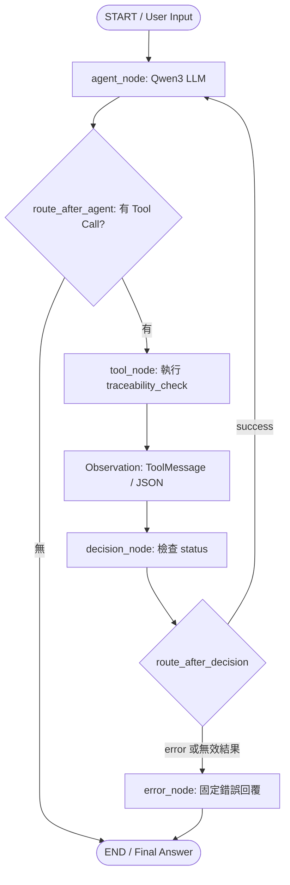

# ISO 26262 功能安全文件審查 AI Agent

**指定作業二：可執行 Agent + Tool Calling / State-based Decision（MVP）**  
**專案完整題目：** 基於 LLM 決策、RAG 與工具調用之 ISO 26262 功能安全文件審查 AI Agent  
**技術組合：** Python 3.12 · LangGraph · LangChain · Qwen3 4B Instruct · Ollama · Podman · openpyxl  
**程式碼：** [GitHub Repository](https://github.com/Lincoln951753/ISO26262_AI_Agent)  
**本階段繳交期限：** 2026-11-22

> **本 README 是第二次作業的主要實作說明與驗收入口。** 老師可直接閱讀本文件，確認作業要求、技術選擇、原始碼位置、Tool 規格、完整 Agent Trace、Failure Cases，以及從 GitHub 使用 Podman 重現執行的方法。成果報告用於協助閱讀，並非必要資訊的唯一存放位置。
>
> **範圍聲明：** 現階段僅以模擬 Excel 檢查 SG → FSR → TSR 的**結構化追溯關係**；尚未實作 ISO 26262 正式條款 RAG、PDF 語義審查或符合性判定。發現缺漏不等於已證明違反 ISO 26262。

---

## 1. 老師作業要求與繳交內容對照

本節為助教快速驗收入口。第二次作業重點是將第一次的設計轉為**真正可執行的 Agent**，而非只交設計圖或由 LLM 單純問答。本專案採用老師允許的 **Tool Calling + State-based Decision**，不宣稱已完成完整 ReAct / 自主多步規劃。

### 1.1 第二次作業必要項目（6.1、6.2、6.6）

| 老師要求 | 本專案如何對應 | 直接查看 |
| --- | --- | --- |
| 6.1：第一次作業規劃轉為可執行 Agent | 以 LangGraph StateGraph 建立 Agent、Tool、Decision、Error 節點 | [agent.py](agent.py)、[第 3 節](#3-系統架構與-agent-決策流程) |
| 6.1：Tool / Workflow / State-based Decision | LLM 選擇 `traceability_check`；執行後依 Observation `status` 決定下一個節點 | [第 3 節](#3-系統架構與-agent-決策流程)、[第 6 節](#6-完整-agent-執行追蹤trace) |
| 6.2：User Input → Agent → LLM/Agent Logic → Output | 已實際執行三組端到端測試 | [第 6 節](#6-完整-agent-執行追蹤trace) |
| 6.2：至少一個真正可執行 Tool | `traceability_check` 以 `openpyxl` 讀取 Excel，實際檢查需求 ID | [tools/traceability_check.py](tools/traceability_check.py)、[第 4 節](#4-tool-definition完整規格) |
| 6.6（1）：Agent 原始碼 | LangGraph Agent 主程式、Python Tool、Containerfile、依賴表 | [agent.py](agent.py)、[tools](tools/)、[Containerfile](Containerfile)、[requirements.txt](requirements.txt) |
| 6.6（2）：Tool 定義（名稱／用途／輸入／輸出／錯誤處理） | 本 README 詳列 JSON 範例、驗證規則及各類錯誤 | [第 4 節](#4-tool-definition完整規格)、[TOOL_DEFINITION.md](TOOL_DEFINITION.md) |
| 6.6（3）：完整執行追蹤 | User Input → 第一次 Decision → Tool Call → Observation → 第二次 Decision → Final Answer | [第 6 節](#6-完整-agent-執行追蹤trace)、[logs](logs/) |
| 6.6（4）：至少兩個 Failure Cases | FC-01 缺少檔案；FC-02 必要欄位缺失，均包含原因、回應及改善方法 | [第 7 節](#7-測試結果與兩個-failure-cases) |
| Podman 容器執行與部署說明 | Ollama、Python Agent 均在 Podman 容器內運行；附 Clone、Build、Run、Test 指令 | [第 5 節](#5-使用-podman-從-github-建置與執行) |
| AI 輔助開發紀錄及技術理解 | 說明 AI 協助範圍、實際操作、除錯、設計理由 | [第 9 節](#9-開發過程技術理解ai-輔助與實作驗證) |

### 1.2 對照第二次作業評分項目（合計 20%）

| 評分項目 | 配分 | 本專案對應證據 |
| --- | ---: | --- |
| Working Agent | 6% | `agent.py`、第 5 節執行指令、第 6 節端到端 Trace |
| Tool / Workflow / ReAct / Planning | 5% | LangGraph + 真實 Python Tool + 條件式決策 |
| 功能完整性 | 3% | SG / FSR / TSR Excel ID 追溯性 MVP；第 4、7 節 |
| Error Handling | 2% | `error_node`；FC-01 / FC-02 |
| Testing / Failure Evidence | 2% | 第 6 節三份完整 Trace、第 7 節預期與實際結果 |
| README / Environment | 2% | 第 5 節部署方法、第 8 節環境與重現限制 |

**以上為證據位置對照，不代表老師已經核定得分。**

---

## 2. 專案目標、背景與本階段範圍

### 2.1 專案要解決的問題

車輛功能安全開發中的 HARA、FSC、TSC 等文件，常需要人工確認安全目標（SG）、功能安全需求（FSR）、技術安全需求（TSR）之間的追溯關係。當文件版本增加時，可能出現未建立關聯、引用錯誤或證據不完整等問題。

第一次作業規劃的最終目標是讓 Agent 結合文件解析、RAG、Tool Calling 與受控決策流程，輔助功能安全工程師執行初步審查、查找依據及產生 Gap Analysis Report，最後仍由工程師確認。

### 2.2 第二次作業的 MVP 目標

本階段聚焦**驗證 Agent 真的能執行工作**，縮小為以下閉環：

1. 接收由 `REVIEW_FILE` 指定的使用者審查需求。
2. 本地 Qwen3 模型判斷並呼叫 `traceability_check`。
3. Python 工具讀取模擬 Excel 並驗證 SG → FSR → TSR 的 ID 關係。
4. LangGraph 根據工具結果進行 **State-based Decision**。
5. 成功時交給 LLM 整理結果；失敗時由 `error_node` 產生可驗證的固定錯誤回報。
6. 以 Podman 執行整套 Agent，保留完整的 Trace 供檢查。

### 2.3 已完成與尚未完成

| 功能 | 狀態 | 說明 |
| --- | --- | --- |
| 本地 LLM（Qwen3 + Ollama） | 已測試 | 透過容器間 HTTP API 呼叫 |
| 真正的 Python Tool Calling | 已測試 | 模型輸出工具名稱與參數、Tool Node 實際執行 |
| SG／FSR／TSR 追溯性檢查 | 已測試 | Excel 欄位、ID 與引用關係 |
| Observation + State-based Decision | 已測試 | `success → agent`、`error → error` |
| Failure Cases | 已測試 | 檔案不存在、欄位缺失 |
| Podman 上的 Agent 與 Ollama | 已測試 | Windows 11 + WSL2 |
| ISO 26262 條款 RAG | 未實作 | 後續作業 |
| PDF 文件解析、語義／ASIL 審查 | 未實作 | 後續作業 |
| 真實 HARA／FSC／TSC 審查 | 未驗證 | 目前只使用模擬 Excel |
| 另一平台上的完整部署重現 | 尚未驗證 | 詳見第 8 節 |

---

## 3. 系統架構與 Agent 決策流程

### 3.1 容器與元件架構

```text
Windows 11 / WSL2
      |
      v
Podman Engine / Podman Network: iso26262-net
      |
      +-- Ollama Container (ollama)
      |     - Model: qwen3:4b-instruct
      |     - API: http://ollama:11434
      |
      +-- Python Agent Container (iso26262-agent:dev)
            - Python 3.12
            - LangGraph / LangChain
            - agent.py
            - tools/traceability_check.py
            - test_data/*.xlsx
```

使用者輸入在目前版本由 `agent.py` 根據 `REVIEW_FILE` 環境變數形成，尚無 Web UI、檔案上傳或任意文字聊天介面。**LLM Server 與 Agent 都採用 Podman 容器**，符合本專案的部署選擇。

### 3.2 Agent Graph（本階段採 State-based Decision）



**流程設計重點：**

- **第一次 Agent Decision（LLM）：** 模型根據請求選擇 `traceability_check`，提出 `file_path` 參數；LLM 並不直接執行 Python。
- **Tool Call / Observation（Python）：** `tool_node` 實際呼叫工具，回傳包含 `status` 的 JSON。
- **第二次 Agent Decision（程式化）：** `decision_node` 根據工具結果設定 `tool_decision`；`route_after_decision` 選擇下一節點。此步是**State-based Decision**，不是 LLM 自主 Replanning。
- **成功路徑：** 回到 `agent_node`，由模型根據觀察結果整理自然語言回答。
- **失敗路徑：** 前往 `error_node`，使用實際錯誤訊息產生固定回覆，避免 LLM 編造需求 ID、Excel 行號或符合性結論。

### 3.3 原始碼節點與責任

| 元件 | 位置 | 工作 |
| --- | --- | --- |
| `ReviewState` | [`agent.py`](agent.py) | 保存 MessagesState 及 `tool_decision` 狀態 |
| `agent_node()` | [`agent.py`](agent.py) | 請 Qwen3 決定工具呼叫或生成回答 |
| `route_after_agent()` | [`agent.py`](agent.py) | 根據是否有 `tool_calls` 決定執行 Tool 或結束 |
| `tool_node()` | [`agent.py`](agent.py) | 驗證 Tool 名稱，實際執行 Python Tool 並包裝為 ToolMessage |
| `latest_tool_observations()` | [`agent.py`](agent.py) | 讀取最新一批 Tool 結果並解析 JSON |
| `decision_node()` | [`agent.py`](agent.py) | 判斷 Observation 成功／失敗，保存下一個節點與理由 |
| `route_after_decision()` | [`agent.py`](agent.py) | 依狀態導向 `agent` 或 `error` |
| `error_node()` | [`agent.py`](agent.py) | 根據實際 Error Observation 產生固定錯誤報告 |
| `traceability_check()` | [`tools/traceability_check.py`](tools/traceability_check.py) | 解析 Excel 與檢查 SG／FSR／TSR 追溯關係 |

### 3.4 為何使用 LangGraph？

使用 StateGraph 的原因是將 **LLM 工具選擇、程式實際執行、條件式決策、錯誤處理**分離為可檢查的節點，讓每一步都能被追蹤與測試。這個 MVP 不依賴模型自行判斷錯誤是否有效，避免在工具失敗時繼續生成無依據的結論。

---

## 4. Tool Definition（完整規格）

### 4.1 工具名稱、用途與實際執行方式

| 欄位 | 說明 |
| --- | --- |
| **Tool Name** | `traceability_check` |
| **Purpose** | 針對 Excel 中 SG → FSR → TSR 的**結構化 ID 追溯關係**執行規則檢查 |
| **Tool Binding** | `@tool("traceability_check")` / `check_excel()` |
| **Actual Implementation** | `tools/traceability_check.py`，透過 `openpyxl` 讀取工作表與列資料 |
| **Input** | `file_path: str`，例如 `safety_requirements.xlsx` |
| **Output** | JSON 字串；正常有 `status`、`summary`、`issues`，失敗有 `status`、`message` |
| **Error Handling** | Tool 回傳 `status=error`，LangGraph 導向 `error_node`，不交由 LLM 編造結果 |

模型呼叫工具的參數範例：

```python
{"file_path": "safety_requirements.xlsx"}
```

**存取限制：** 工具僅允許使用 `/app/test_data/` 下的 `.xlsx` **檔名**，不接受帶有 `/`、`\\` 路徑分隔符的輸入，且僅接受 `.xlsx` 檔名，以限制任意檔案讀取。`test_data/` 中的檔案會在 Build 階段複製至容器。

### 4.2 Excel Input Schema

| 工作表 | 必要欄位 | 欄位意義 |
| --- | --- | --- |
| `SG` | `ID`, `Description` | 安全目標 ID 與描述 |
| `FSR` | `ID`, `SG_ID`, `Description` | 功能安全需求 ID、所參照的 SG ID 與描述 |
| `TSR` | `ID`, `FSR_ID`, `Description` | 技術安全需求 ID、所參照的 FSR ID 與描述 |

**欄位名稱為本專案測試格式，不是 ISO 26262 標準規定的固定欄名。**

### 4.3 Processing Logic

1. 檢查指定 Excel 檔案是否存在。
2. 使用 `openpyxl` 開啟檔案，確認 `SG`、`FSR`、`TSR` 工作表存在。
3. 確認每張工作表具有必要欄位。
4. 逐列讀取資料，保存實際 Excel 列號（標題為第 1 列，資料從第 2 列開始）。
5. 確認每筆 FSR 的 `SG_ID` 是否引用有效 SG。
6. 確認每筆 TSR 的 `FSR_ID` 是否引用有效 FSR。
7. 列出沒有被 FSR 關聯的 SG、沒有被 TSR 關聯的 FSR。
8. 輸出結構化 JSON，供 Agent 後續決策及摘要使用。

**可回報的追溯性問題類型：** `INVALID_SG_REFERENCE`、`INVALID_FSR_REFERENCE`、`SG_WITHOUT_FSR`、`FSR_WITHOUT_TSR`。

### 4.4 Output — Success 範例（TC-01 實測結果）

```json
{
  "status": "success",
  "summary": {
    "SG_count": 2,
    "FSR_count": 2,
    "TSR_count": 1,
    "issue_count": 1
  },
  "issues": [
    {
      "type": "FSR_WITHOUT_TSR",
      "requirement": "FSR-002",
      "row": 3,
      "message": "FSR FSR-002 has no TSR"
    }
  ]
}
```

這裡 `status=success` **代表工具成功完成檢查**，不代表「沒有發現追溯問題」；本案例仍有一項 `issue`。

### 4.5 Output — Error 範例（FC-02 實測結果）

```json
{
  "status": "error",
  "message": "FSR missing columns: ['SG_ID']"
}
```

### 4.6 Tool Error Handling

| 錯誤類型 | 產生原因 | 工具回覆／處理方法 |
| --- | --- | --- |
| Invalid File Path | 非 `.xlsx`、包含目錄路徑或無效檔名 | 拒絕讀取，回報允許的檔名格式 |
| File Not Found | `/app/test_data/` 找不到指定檔案 | `File not found: ...` |
| Missing Sheet | 缺少 `SG`、`FSR` 或 `TSR` | `Missing sheet: ...` |
| Missing Column | 必要欄位未出現 | `[sheet] missing columns: [...]` |
| Empty Sheet | 工作表完全沒有標題資料列 | `Empty sheet: ...` |
| Excel Parsing Error | Excel 讀取／解析例外 | `Excel parsing failed: ...` |
| Invalid Tool Response | Observation 無法轉成預期 JSON 物件 | Decision Node 視為錯誤並導向 Error Node |
| Unknown Tool / Execution Exception | 模型提出未知工具或執行時拋出例外 | Tool Node 包裝為 `status=error` 結果 |

更多詳細定義另見 [TOOL_DEFINITION.md](TOOL_DEFINITION.md)。

---

## 5. 使用 Podman 從 GitHub 建置與執行

> **重現目標：** 使用者取得此 Repository 後，能自行使用 Podman 建置 Agent、啟動 Ollama、執行三組測試並比對第 6、7 節的結果。以下指令以 **Windows 11 / PowerShell + WSL2 + Podman** 為實際測試環境；尚未宣稱其他作業系統已驗證。

### 5.1 環境需求

| 項目 | 本次已測試環境 |
| --- | --- |
| 主機 | Windows 11 x64 |
| CLI / IDE | PowerShell、Visual Studio Code、Git |
| 容器引擎 | Podman CLI 6.1.4 + Podman Machine（WSL2） |
| Agent Image | `docker.io/library/python:3.12-slim` 為基底 |
| Python packages | LangGraph、LangChain Core、LangChain Ollama、openpyxl 3.1.5 |
| LLM Server | Ollama 容器（開發時 API 0.40.16） |
| 模型 | `qwen3:4b-instruct` |
| Container Network | `iso26262-net` |

需先安裝 **Git、WSL2、Podman CLI / Podman Desktop** 並建立 Podman Machine；首次拉取映像與模型需要網路，模型檔案需要足夠儲存空間。

### 5.2 驗證 Podman 並 Clone 專案

```powershell
podman --version
podman machine list
podman machine start
podman info

git clone https://github.com/Lincoln951753/ISO26262_AI_Agent.git
cd ISO26262_AI_Agent
```

若 Machine 已經啟動，`podman machine start` 顯示「已執行」相關訊息時可略過。若尚未建立 Machine，請先透過 Podman Desktop 完成初始化。

### 5.3 建立網路並啟動 Ollama

```powershell
podman network create iso26262-net
podman run -d --name ollama --network iso26262-net -p 127.0.0.1:11434:11434 -v ollama:/root/.ollama docker.io/ollama/ollama:latest
podman exec ollama ollama pull qwen3:4b-instruct
podman exec ollama ollama list
```

同名網路／容器已存在時**不必重複建立**。可先用 `podman ps -a`、`podman network ls` 檢查；若 `ollama` 容器已停止，使用 `podman start ollama`。若既有容器未連上 `iso26262-net`，使用 `podman network connect iso26262-net ollama`。

測試 Ollama API 與容器之間的 DNS／HTTP：

```powershell
Invoke-RestMethod -Uri http://127.0.0.1:11434/api/version
podman run --rm --network iso26262-net docker.io/library/python:3.12-slim python -c "import urllib.request; print(urllib.request.urlopen('http://ollama:11434/api/version').read().decode())"
```

`OLLAMA_BASE_URL=http://ollama:11434` 是 **Podman 網路中 Agent 容器連接 Ollama 的位址**；不要改成 Agent 容器內部的 `localhost`。

### 5.4 Build Python Agent Container

在 Repository 根目錄執行：

```powershell
podman build -t iso26262-agent:dev -f Containerfile .
```

`Containerfile` 會安裝 `requirements.txt` 並複製 `agent.py`、`tools/`、`test_data/`。修改程式或模擬 Excel **後必須重新 Build**，才能讓容器使用新版內容。

### 5.5 執行正常案例（TC-01）

```powershell
podman run --rm --network iso26262-net -e OLLAMA_BASE_URL=http://ollama:11434 -e REVIEW_FILE=safety_requirements.xlsx iso26262-agent:dev
```

**應觀察到：** `Agent Decision (before Tool Call)`、`traceability_check`、`Observation`、`Agent Decision (after Observation)`、`Final Answer`，並指出 **FSR-002（Excel 第 3 列）缺少 TSR**。

### 5.6 執行兩個 Failure Cases

```powershell
# FC-01: 檔案不存在
podman run --rm --network iso26262-net -e OLLAMA_BASE_URL=http://ollama:11434 -e REVIEW_FILE=not_found.xlsx iso26262-agent:dev

# FC-02: FSR 必要欄位 SG_ID 不存在
podman run --rm --network iso26262-net -e OLLAMA_BASE_URL=http://ollama:11434 -e REVIEW_FILE=fc02_missing_column.xlsx iso26262-agent:dev
```

**應觀察到：** `Observation Status: error`、`Next Node: error`，並分別回報 File Not Found、`FSR missing columns: ['SG_ID']`。

### 5.7 儲存測試 Trace（PowerShell）

在 Repository 根目錄執行，三條命令會覆蓋既有檔案：

```powershell
cmd /c "podman run --rm --network iso26262-net -e OLLAMA_BASE_URL=http://ollama:11434 -e REVIEW_FILE=safety_requirements.xlsx iso26262-agent:dev > logs\tc01_trace.txt 2>&1"
cmd /c "podman run --rm --network iso26262-net -e OLLAMA_BASE_URL=http://ollama:11434 -e REVIEW_FILE=not_found.xlsx iso26262-agent:dev > logs\fc01_trace.txt 2>&1"
cmd /c "podman run --rm --network iso26262-net -e OLLAMA_BASE_URL=http://ollama:11434 -e REVIEW_FILE=fc02_missing_column.xlsx iso26262-agent:dev > logs\fc02_trace.txt 2>&1"
```

先前使用 PowerShell 5.1 的 `Tee-Object` 曾發生中文亂碼，因此本專案改用 `cmd /c` 重導向並檢查文字檔內容。完成後可用 VS Code 開啟 `logs/*.txt`，確認沒有編碼問題。

---

## 6. 完整 Agent 執行追蹤（Trace）

本節直接列出三組**實際執行後的終端機輸出**，而不只提供檔案連結，讓老師在 README 就能看到完整流程。三組輸出均來自 Windows / WSL2 / Podman / Ollama 的本機執行測試；LLM 自然語言回答可能因模型生成而略有差異，**Tool Observation 與路由判斷才是主要驗收依據**。

**作業要求的六步驟：** `User Input → Agent Decision → Tool Call → Observation → Agent Decision → Final Result`

### 6.1 TC-01：正常格式，有一筆追溯缺漏

**Input：** `safety_requirements.xlsx`。**預期：** 工具成功執行，找到 `FSR-002` 沒有 TSR，且提供實際 Excel 列號。

```text
=== User Input ===
請使用工具檢查 safety_requirements.xlsx 的 SG、FSR、TSR 追溯關係，列出問題與 Excel 列號。如果檔案不存在，請明確回報錯誤，不要自行推測審查結果。

=== Agent Decision (before Tool Call) ===
Decision: call the tool(s) listed below

=== Tool Call ===
Tool: traceability_check
Arguments: {'file_path': 'safety_requirements.xlsx'}

=== Observation ===
{"status": "success", "summary": {"SG_count": 2, "FSR_count": 2, "TSR_count": 1, "issue_count": 1}, "issues": [{"type": "FSR_WITHOUT_TSR", "requirement": "FSR-002", "row": 3, "message": "FSR FSR-002 has no TSR"}]}

=== Agent Decision (after Observation) ===
Observation Status: success
Next Node: agent
Reason: Tool check succeeded; return results to the LLM for analysis.

=== Final Answer ===
追蹤問題：
- FSR-002（Excel 第 3 列）無對應的 TSR 要求。
```

**判讀：** LLM 決定使用工具；Python Tool 實際讀取 Excel；LangGraph 因 `status=success` 回到 LLM；最終回答與 Tool Observation 的 ID、列號一致。`issue_count=1` 表示找到一筆缺漏，**不是正式 ISO 26262 合規評定**。

**完整紀錄檔：** [logs/tc01_trace.txt](logs/tc01_trace.txt)

### 6.2 FC-01：檔案不存在

**Input：** `not_found.xlsx`（刻意不提供此檔案）。**預期：** 回報找不到檔案，不編造追溯性結果。

```text
=== User Input ===
請使用工具檢查 not_found.xlsx 的 SG、FSR、TSR 追溯關係，列出問題與 Excel 列號。如果檔案不存在，請明確回報錯誤，不要自行推測審查結果。

=== Agent Decision (before Tool Call) ===
Decision: call the tool(s) listed below

=== Tool Call ===
Tool: traceability_check
Arguments: {'file_path': 'not_found.xlsx'}

=== Observation ===
{"status": "error", "message": "File not found: /app/test_data/not_found.xlsx"}

=== Agent Decision (after Observation) ===
Observation Status: error
Next Node: error
Reason: Tool check failed or response was invalid; use fixed error handling.

=== Final Answer ===
本次追溯性檢查無法完成。
工具回報：File not found: /app/test_data/not_found.xlsx
請確認並修正輸入檔案後重新執行。
由於檢查未完成，無法判定需求追溯關係是否完整，也無法據此判定 ISO 26262 符合性。
```

**判讀：** Tool 正確回傳檔案不存在，`decision_node` 指向 `error`；固定錯誤訊息保留了原始 Tool 錯誤，沒有虛構缺漏需求。

**完整紀錄檔：** [logs/fc01_trace.txt](logs/fc01_trace.txt)

### 6.3 FC-02：FSR 缺少必要欄位 `SG_ID`

**Input：** `fc02_missing_column.xlsx`。**預期：** 指出 FSR 工作表缺少 `SG_ID`，停止審查並保留確切的錯誤訊息。

```text
=== User Input ===
請使用工具檢查 fc02_missing_column.xlsx 的 SG、FSR、TSR 追溯關係，列出問題與 Excel 列號。如果檔案不存在，請明確回報錯誤，不要自行推測審查結果。

=== Agent Decision (before Tool Call) ===
Decision: call the tool(s) listed below

=== Tool Call ===
Tool: traceability_check
Arguments: {'file_path': 'fc02_missing_column.xlsx'}

=== Observation ===
{"status": "error", "message": "FSR missing columns: ['SG_ID']"}

=== Agent Decision (after Observation) ===
Observation Status: error
Next Node: error
Reason: Tool check failed or response was invalid; use fixed error handling.

=== Final Answer ===
本次追溯性檢查無法完成。
工具回報：FSR missing columns: ['SG_ID']
請確認並修正輸入檔案後重新執行。
由於檢查未完成，無法判定需求追溯關係是否完整，也無法據此判定 ISO 26262 符合性。
```

**判讀：** Tool 回傳真實的欄位缺失；Agent 走錯誤節點，不把「缺欄位」誤判為已確認的功能安全不符合項。

**完整紀錄檔：** [logs/fc02_trace.txt](logs/fc02_trace.txt)

> **重要：** 本節是已完成的新版**本機測試輸出**。若 GitHub 上的 `agent.py` 或 `logs/*.txt` 仍顯示舊版 `=== Agent Action ===`，請先同步本機新版原始碼及三份 Trace，才能讓 Repository 證據與本 README 完全一致。

---

## 7. 測試結果與兩個 Failure Cases

### 7.1 測試案例與驗收結果

| Case | 類型 | 輸入／測試情境 | 預期結果 | 實際結果 | 本機測試 |
| --- | --- | --- | --- | --- | --- |
| **TC-01** | 正常執行／資料缺漏 | `safety_requirements.xlsx`；格式完整但 FSR-002 無 TSR | JSON `status=success` 並指出需求 ID、列號 | `FSR_WITHOUT_TSR`、`FSR-002`、Excel 第 3 列；下一節點 `agent` | **PASS** |
| **FC-01** | Failure Case 1 | `not_found.xlsx` 不存在 | 明確報錯，不能虛構審查問題 | `File not found: /app/test_data/not_found.xlsx`；下一節點 `error` | **PASS** |
| **FC-02** | Failure Case 2 | FSR 工作表缺少 `SG_ID` | 指出欄位錯誤，停止審查 | `FSR missing columns: ['SG_ID']`；下一節點 `error` | **PASS** |

**PASS 定義：** 本表 PASS 指該測試的 **Tool Observation、Decision 分流及 Final Answer 符合本案預期**；不代表被檢查 Excel 沒有問題，更不代表通過 ISO 26262 合規認證。

### 7.2 Failure Case 1 — File Not Found

- **錯誤情境：** `REVIEW_FILE=not_found.xlsx`，容器內 `/app/test_data/` 無此檔案。
- **原因分析：** Python Tool 的 `Path.is_file()` 檢查失敗，無法取得 Excel 內容，不能繼續判讀 SG／FSR／TSR。
- **系統處理：** 回傳 `status=error` 與真實檔案路徑；`decision_node` 選擇 `error`；`error_node` 說明檢查未完成。
- **改善／使用者處置：** 確認檔名與檔案是否放入 `test_data/`，若新增檔案則重新 Build Agent Image，再重新執行。
- **驗證：** 第 6.2 節與 [FC-01 Trace](logs/fc01_trace.txt)，結果 PASS。

### 7.3 Failure Case 2 — Missing Required Column

- **錯誤情境：** 使用缺少 `SG_ID` 必要欄位的模擬 Excel。
- **原因分析：** FSR 無法提供所對應的 SG ID，檢查程式不能可靠地建立 FSR → SG 關聯。
- **系統處理：** 回傳 `FSR missing columns: ['SG_ID']`，路由至 `error_node`，而不是編造需求行號或 ISO 26262 判斷。
- **改善／使用者處置：** 補齊 FSR 表的 `SG_ID` 欄，確認欄名符合工具定義，再重新檢查；若修改測試檔，需重新 Build。
- **驗證：** 第 6.3 節與 [FC-02 Trace](logs/fc02_trace.txt)，結果 PASS。

### 7.4 為何最後增加 `error_node`？

開發初期，工具回報 `status=error` 後仍將結果交由 LLM 自由生成，曾出現模型額外補充不存在的行號／欄位。即使強化 Prompt，仍不能保證每次都正確。因此改為**用程式決定錯誤路徑，直接引用 Observation**，減少模型幻覺造成的錯誤結論。這是實際測試後採取的流程改善，而非只停留在規劃文件。

---

## 8. 容器化驗證、重現性與驗收門檻

### 8.1 目前完成的環境驗證

| 驗證事項 | 已觀察到的結果 |
| --- | --- |
| Podman Linux Container | `hello-world` 可執行 |
| Ollama Container | 可使用 `/api/version` 與下載模型 |
| Agent → Ollama | 透過 `http://ollama:11434` 通訊，模型可輸出 Tool Call |
| Python Tool | 真的讀取 Excel 並回傳 JSON |
| LangGraph | Success / Error 兩路分流可觀察 |
| Agent End-to-End | TC-01、FC-01、FC-02 三組皆已在本機執行成功 |
| Trace | 三組輸出皆顯示兩次 Decision 及 Final Answer |

### 8.2 重現性現況與限制

課程強調 Agent 必須可以透過 **Podman Engine** 執行，並重視在不同平台重現。**目前確認的是 Windows 11 + WSL2 + Podman 環境；尚未在另一台乾淨電腦或不同作業系統完整驗證，因此不能宣稱已達成跨平台實測。**

目前也尚未完成完全鎖版的依賴管理：`requirements.txt` 對部分 LangGraph / LangChain 套件使用版本區間，Ollama Image 使用 `latest`。這可能造成未來重新部署時的版本差異。另尚未驗證 GPU passthrough，現階段不以 GPU 為必要條件。

### 8.3 本階段明確驗收標準

| 驗收目標 | 可觀察門檻 | 狀態 |
| --- | --- | --- |
| Agent 可以實際執行 | Podman Container 能啟動並完成一次端到端工作 | 已達成（本機） |
| 有真正執行的 Tool | Observation 來自 Python Excel 解析，不是模型自行生成 | 已達成 |
| 決策與流程可追蹤 | Trace 包含輸入、兩次 Decision、Tool、Observation、Final Answer | 已達成（本機） |
| 正常案例正確 | TC-01 找出 FSR-002 並回報第 3 列 | 已達成 |
| 至少兩種錯誤情境 | FC-01、FC-02 都走固定錯誤路徑且不捏造結果 | 已達成 |
| Repository 可供他人部署 | 包含原始碼、Containerfile、README、模擬資料、測試紀錄 | 文件／檔案已建立，需確認最新版本同步 |
| 乾淨環境重新 Clone → Build → Run | 在新目錄完整執行並保存結果 | 尚待驗證 |
| 不同平台 Podman 重現 | 在另一平台完成同樣測試並保存結果 | 尚待驗證 |

---

## 9. 開發過程：技術理解、AI 輔助與實作驗證

### 9.1 開發方式與 AI 輔助範圍

本專案以對 **LLM、AI Agent、Tool Calling 及程式執行流程的基本理解**為基礎，進行系統架構規劃與功能實作，並使用 ChatGPT 作為輔助開發工具，協助程式撰寫、技術設定與問題排除。

在架構設計上，理解 Agent 如何接收任務、由 LLM 選擇 Tool、交由 Python 執行實際工作，以及根據 Observation 由 LangGraph 進行條件式分流。AI 主要協助以下內容：

- **程式開發輔助：** 提供部分 Python Tool、LangGraph 節點與 Trace 輸出的程式範例，依需求進行修改。
- **環境建置：** 提供 Podman、Ollama、LangGraph 的安裝、設定與容器通訊建議。
- **問題分析與除錯：** 協助判讀錯誤訊息，討論可行修正方式。
- **測試設計：** 協助整理正常案例、Failure Cases、預期結果與驗收方法。
- **文件整理：** 輔助撰寫 README、Tool Definition、測試與專案說明。

AI 提供的建議或程式碼**不直接等於已驗證成果**。本專案透過實際建置、執行、觀察 Console / Trace、確認結果及重新測試，才將相應功能標示為完成。開發方式是**理解原理 + AI 輔助實作 + 實際操作與驗證**，並不宣稱全部程式碼皆由學生獨立從零撰寫。

### 9.2 實際操作與確認的工作

| 開發階段 | 實際執行及確認的內容 |
| --- | --- |
| 執行環境 | 安裝 WSL2、Podman Desktop / CLI，建立並啟動 Podman Machine |
| 容器基本驗證 | 執行 `hello-world`，確認可啟動 Linux 容器 |
| 本地 LLM | 建立 Ollama 容器、下載 Qwen3、測試 `/api/version` 與模型呼叫 |
| Tool Calling | 透過 Ollama API 確認模型可輸出 `traceability_check` 與 `file_path` |
| Python Tool | 在 VS Code 建立工具與模擬 Excel，利用 Podman 執行並檢查 JSON |
| Agent Workflow | 建立 LangGraph Agent，驗證 Action、Observation 與分流結果 |
| 決策追蹤 | 增加 `decision_node`，實際確認 `success → agent` / `error → error` |
| 測試與修正 | 執行 TC-01、FC-01、FC-02，依測試結果修改、重建與再測 |
| 版本管理與文件 | 保存 Trace、整理 README / Tool Definition、建立 Git 與 GitHub Repository |

### 9.3 開發中遇到的問題與解決

| 遇到的問題 | 原因分析與修正 | 驗證結果 |
| --- | --- | --- |
| PowerShell 出現 `host directory cannot be empty` | 修正掛載路徑展開方式，由 `${PWD.Path}` 改為 `$($PWD.Path)` | Tool 容器可讀取測試 Excel |
| Python `IndentationError` | 統一程式區塊縮排，使用 `ast.parse()` 驗證語法 | 顯示 `Syntax OK`，後續容器可執行 |
| `REVIEW_FILE` 指定後仍使用舊檔名 | 確認環境變數讀取，修改並儲存 `agent.py` 後重新 Build | FC-01 正確呼叫 `not_found.xlsx` |
| Trace 中文亂碼 | `Tee-Object` 文字編碼不符合預期，改用 CMD 重導向 | UTF-8 中文內容可正常檢視 |
| LLM 在錯誤情境編造欄位與行號 | Prompt 補強仍有風險；改由 `error_node` 固定處理 `status=error` | FC-02 正確回報 `SG_ID` 缺漏 |
| Trace 未清楚列出第二次決策 | 增加 `decision_node` 與 `tool_decision` 狀態欄位 | 三組測試均顯示 Observation 後的下一個節點 |

### 9.4 技術理解與設計理由

**（1）為何不能只靠 LLM 直接閱讀與回答？**  
模型可能誤解 SG / FSR / TSR，或對不存在的資料生成合理但不正確的內容。對於可規則化的 Excel 欄位與 ID 引用檢查，使用 Python 更容易得到可驗證的結果。

**（2）Tool Calling 是否代表 LLM 直接執行 Python？**  
不是。LLM 輸出工具名稱與參數，真正執行的是 LangGraph Tool Node 呼叫 Python 函式。Observation 才是實際工具的輸出。

**（3）為何使用 LangGraph？**  
StateGraph 可以將 LLM、Tool、Decision、Error 拆開，使用條件邊控制成功與失敗路徑，讓每個階段的輸入輸出與錯誤原因都可以觀察。

**（4）為何需要 Error Node？**  
Tool 出錯代表沒有可靠的檢查結果。若仍直接交給 LLM，可能產生未驗證的結論。因此由 Python 固定產出錯誤資訊，降低不實回答的可能。

**（5）本專案是否已完成 ReAct 或 Replanning？**  
沒有。本專案採用 **Tool Calling + State-based Decision**，具備 Observation 後的條件式分流，但尚未實作完整的多步規劃或失敗後自主重試策略。此區分與實作內容一致。

**（6）為何使用 Podman？**  
課程要求 Agent 能以 Podman Engine 執行。容器可封裝 Python 執行環境，並藉由網路連接 Ollama，減少直接依賴主機上 Python 套件的情況。

### 9.5 本階段開發收穫

本次作業從第一次的架構規劃，實際完成 **LLM Tool Calling → Python Tool → Observation → LangGraph 決策 → Final Answer** 的可執行閉環。除理解各元件如何合作外，也透過實際除錯發現：**Agent 的可靠性不能只依賴提示詞，仍需要明確的工具規則、狀態控制與可追溯的測試證據。**

---

## 10. 原始碼與提交檔案索引

所有必要成果均可從本 Repository 取得；老師不需要依賴另一份成果報告才知道如何執行或檢查程式。

```text
ISO26262_AI_Agent/
├── README.md                    # 指定作業二主要實作說明與完整證據
├── agent.py                     # LangGraph Agent / Decision / Error / CLI Trace
├── Containerfile                # Podman Agent 容器建置
├── requirements.txt             # Python 套件需求
├── TOOL_DEFINITION.md           # 獨立 Tool 規格文件
├── test_tool.py                 # Python Tool 獨立執行示例（主機環境）
├── tools/
│   └── traceability_check.py    # openpyxl 追溯性檢查
├── test_data/
│   ├── safety_requirements.xlsx # TC-01 模擬資料
│   └── fc02_missing_column.xlsx # FC-02 模擬資料
└── logs/
    ├── tc01_trace.txt           # 正常案例完整 Trace
    ├── fc01_trace.txt           # 缺少檔案 Failure Case
    └── fc02_trace.txt           # 缺少欄位 Failure Case
```

- **Agent 原始碼：** [agent.py](agent.py)
- **Python Tool：** [traceability_check.py](tools/traceability_check.py)
- **Tool 規格：** [TOOL_DEFINITION.md](TOOL_DEFINITION.md)
- **Podman 建置：** [Containerfile](Containerfile)
- **套件依賴：** [requirements.txt](requirements.txt)
- **正常案例 Trace：** [logs/tc01_trace.txt](logs/tc01_trace.txt)
- **Failure Case 1 Trace：** [logs/fc01_trace.txt](logs/fc01_trace.txt)
- **Failure Case 2 Trace：** [logs/fc02_trace.txt](logs/fc02_trace.txt)

---

## 11. 已知限制、後續時程與改善方向

### 11.1 已知限制

1. 目前僅支援**此專案定義的 Excel 格式及結構化 ID 關聯**，不判讀安全需求文字的語義一致性。
2. 尚未導入 ISO 26262 正式條款 RAG、PDF 解析、ASIL 合理性分析、驗證證據查核或 Gap Analysis Report。
3. 測試用 Excel 為模擬資料，不能推論真實 HARA、FSC、TSC 文件的品質。
4. 成功路徑的最終回答由 LLM 生成，仍可能出現過度肯定措辭；需依 Observation 人工確認。
5. 若 LLM 沒有產生 Tool Call，目前系統沒有強制重試或自主重新規劃機制。
6. 尚未確認不同作業系統的 Podman 重現性；尚未固定所有套件與 Ollama 映像版本。
7. 本專案僅做技術可行性驗證，不能代替功能安全工程師的正式評估或 ISO 26262 符合性認定。

### 11.2 課程後續里程碑

| 課程階段 | 時間 | 預定內容 |
| --- | --- | --- |
| 指定作業二 | 2026-11-22 | 完成可執行 Agent、真實 Tool、Decision Trace、兩個 Failure Cases 與 Podman README |
| 指定作業三 | 2026-12-06 | 擇一強化功能，例如合法來源的 RAG 或審查能力，完成至少 10 個測試並比較改善效果 |
| 期末作業 | 2026-12-27 | 擴充文件解析、檢索、證據引用與報告輸出，完成系統文件與重現性驗證 |

未完成的功能均標示為**後續規劃**，不列入本次已驗證成果。

---

## 12. 使用與資料安全聲明

本專案僅供課程實作與功能安全文件審查流程的技術研究。Repository 使用模擬 Excel，**不包含 ISO 26262 受版權保護標準原文、車廠機敏文件或帳號憑證**。若未來導入真實資料或合法授權的標準內容，需另行控管資料來源、權限及保密要求。

**所有工具輸出應視為待人工複核的輔助資訊，不構成 ISO 26262 符合性或不符合性的正式判定。**
